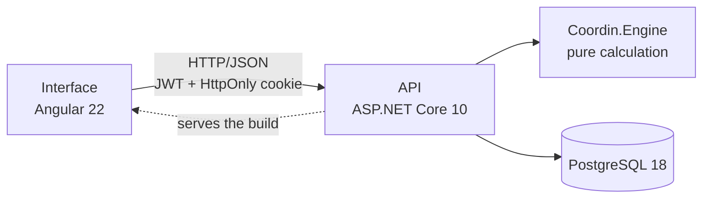

# Coordin

> A decision-support system that turns prioritized demands, estimated effort, and team capacity into **delivery forecasts**, compares alternative execution sequences, and points out idle time and overload.

🇺🇸 English · 🇧🇷 [Português](README.md)

---

## Demo

https://github.com/user-attachments/assets/0dc20095-0e77-4d43-aade-13679d41c452

*Video without audio. It shows the main flow: registration, schedule, team report, and scenarios.*

---

## Table of contents

- [About the project](#about-the-project)
- [The problem](#the-problem)
- [How it works](#how-it-works)
- [Features](#features)
- [Business rules](#business-rules)
- [Architecture](#architecture)
- [Technologies](#technologies)
- [Repository structure](#repository-structure)
- [Running locally](#running-locally)
- [Tests and checks](#tests-and-checks)
- [Deployment](#deployment)
- [Project documentation](#project-documentation)
- [Status](#status)
- [Contributing](#contributing)
- [Academic context](#academic-context)
- [License](#license)

---

## About the project

Coordin was built for the **development manager**, who needs to answer the product manager with confidence:

> **"When can each demand be delivered, given the real capacity of the teams?"**

From the demands, the teams' estimates, and each person's availability, the system calculates:

- a **schedule** with the forecast end date of each demand, with and without a safety margin;
- a **team report** with occupancy, idle time, and overload week by week;
- **sequencing scenarios** with the impact of each alternative;
- **recommendations** that the manager can approve or reject.

The central principle: **the manager decides; the system calculates, shows the impact, and recommends.**

## The problem

Planning deliveries gets hard when many demands compete for attention and several teams take part in each one. Some demands involve a single team; others need several teams working together.

Common pain points:

- There is no consolidated view of demands, owners, effort, and forecast dates.
- Work is unevenly distributed: some teams sit idle while others are overloaded.
- It is hard to see the impact of a new demand on the existing schedule.
- Comparing alternative sequences to find a more efficient order is laborious and done by hand.
- Forecasts depend on the teams' estimates, not only on priority.

The challenge is not just tracking tasks. It is **coordinating the capacity of several teams** to forecast and improve the department's deliveries.

## How it works

1. **Registration:** the manager records teams, people (with hours per working day), absences, and the department's holidays.
2. **Demands:** each demand has a title, a start date, the teams involved, the effort estimated per team, and the people allocated. A demand can be entered without an estimate or without a start date: the system treats it as **unpredictable** until the information arrives.
3. **Forecast:** the engine simulates, day by day, each person's work in execution order and calculates the end date. It then applies the safety margin, which only extends the deadline.
4. **Analysis:** the schedule and the team report show the department's slack and overload.
5. **Decision:** the system recommends sequencing scenarios with the impact of each one. Nothing changes without the manager's approval.

## Features

### Registration
- **Teams**, with a unique name and a capacity calculated from the sum of their people.
- **People**, with hours per working day (from 0 to 24) and absences.
- **Absences** (vacation or other), with a start and an end date.
- **Department holidays**, which do not count as working days.

### Demands
- Registration with title, start date, optional stated end date, optional effort per team, and the people allocated.
- **Priority order** with Move up and Move down, no drag and drop.
- **Dependencies** between demands, with cycle detection and blocking the deletion of a prerequisite that still has dependents.
- **Completion** with the actual date and effort, which feeds the accuracy indicators.
- **History** of estimate and forecast changes, with the reason recorded.

### Schedule and forecast
- Forecast end date **without margin** and **with margin**, with the reason when a demand is unpredictable (no start date, no estimate, no capacity, or an unpredictable prerequisite).
- **Configurable safety margin** (20% by default), applied in working days.
- **Spreadsheet export** (CSV in pt-BR, with the same dates shown on screen).

### Team report
- Capacity, allocated hours, occupancy, and idle hours per week (Monday to Sunday).
- **Overload**: a week in which the team used all of its capacity and still had work waiting.
- Occupancy map and a table with the same values as the chart.

### Sequencing scenarios
- **Recommendations on request:** the system searches for sequences better than the current one and shows the current score, the scenario score, and each demand's contribution.
- **Simulation** of a specific order, without saving anything.
- **Approval** with a two-step confirmation, and **back to priority** at any time.
- The priority set between product and development is preserved: an alternative appears as a recommendation, never as a silent replacement.

### Simulating a new demand
- Shows which existing demands change date if the new demand enters at the chosen position. Nothing is saved.

### Accuracy and validation
- **Forecast accuracy:** indicators comparing the forecast with the actual date and effort of completed demands.
- **Simulation-based validation:** a tool to test the calculation with a fictitious dataset. It is **off by default** and, when enabled, replaces the data in the database.

### Access
- Manager sign-in with a 15-minute session renewed automatically, lockout after 5 wrong passwords, and a per-IP request limit.

## Business rules

These rules apply across the system and change only with explicit approval from the product and development managers.

1. **The safety margin never shortens the deadline.** It can only extend the forecast.
2. **The system never reorders demands on its own.** A sequence change is always a scenario with its impact, waiting for approval or rejection.
3. **The priority between product and development is preserved.** Alternatives are recommendations.
4. **Adding a team does not halve the deadline.** The forecast considers the effective capacity.
5. **A demand may have no effort.** It is accepted and treated as unpredictable until the estimate arrives.

## Architecture

The calculation lives in a pure library, with no database, HTTP, or system clock. The API and the interface consume the engine, and business rules do not spread into controllers or components.



- **`Coordin.Engine`**: forecast, margin, capacity, scenarios, simulation, and indicators. Explicit inputs and outputs, deterministic results.
- **`Coordin.Api`**: endpoints, authentication, persistence (EF Core), validation, and export.
- **`coordin-web`**: the interface, also served by the API itself on the same origin.

## Technologies

| Layer | Technology |
|-------|------------|
| Language and runtime | C# on .NET 10 (LTS) |
| API | ASP.NET Core Minimal APIs, Problem Details, OpenAPI |
| Persistence | EF Core 10 with Npgsql, PostgreSQL 18 |
| Authentication | ASP.NET Core Identity, 15-minute JWT, refresh token in a rotating `HttpOnly` cookie |
| Calculation engine | `Coordin.Engine`, a C# library with no infrastructure dependencies |
| Interface | Angular 22 (standalone components and signals), TypeScript 6, Tailwind CSS 4 |
| Charts | Chart.js 4.6 |
| Tests | xUnit v3, Testcontainers (real PostgreSQL), Vitest, Playwright |
| Quality | `dotnet format`, ESLint, Prettier, .NET analyzers |
| Infrastructure | Docker (one image with the API and the interface), Docker Compose, GitHub Actions |
| Hosting | Container on a PaaS service, with managed PostgreSQL (see [Deployment](#deployment)) |

Technical decisions and the alternatives considered are in [`docs/TDD.md`](docs/TDD.md).

## Repository structure

```
coordin/
├── docs/                        # PRD, TDD, specifications and design
├── openspec/                    # current specs and changes (SDD)
├── src/
│   ├── Coordin.Engine/          # pure calculation engine
│   ├── Coordin.Api/             # ASP.NET Core API
│   └── coordin-web/             # Angular interface
├── tests/
│   ├── Coordin.Engine.Tests/    # engine unit tests
│   └── Coordin.Api.Tests/       # API integration tests
├── compose.yaml                 # local PostgreSQL and production profile
├── Dockerfile                   # single image (API + interface)
└── .github/workflows/ci.yml     # CI: .NET and web jobs
```

## Running locally

### Prerequisites

- [.NET SDK 10](https://dotnet.microsoft.com/download) (the exact version is in `global.json`)
- [Node.js 24 LTS](https://nodejs.org) and npm
- [Docker](https://www.docker.com/products/docker-desktop/) (local PostgreSQL and integration tests)

### Step by step

```bash
# 1. Clone the repository
git clone https://github.com/pedrohenriquedsdev/coordin.git
cd coordin

# 2. Create a local .env with the database password (letters and numbers).
#    The .env file is ignored by Git. Never commit passwords.
echo "POSTGRES_PASSWORD=YOUR_PASSWORD" > .env

# 3. Start PostgreSQL
docker compose up -d

# 4. Set the API secrets with user secrets (outside the repository).
#    The password must be the same as in .env.
dotnet user-secrets set "ConnectionStrings:Default" "Host=localhost;Port=5432;Database=coordin;Username=coordin;Password=YOUR_PASSWORD" --project src/Coordin.Api

# 5. Configure authentication (see "Authentication" below).
dotnet user-secrets set "Jwt:SigningKey" "A_RANDOM_KEY_WITH_AT_LEAST_32_BYTES" --project src/Coordin.Api
dotnet user-secrets set "Manager:Email" "you@example.com" --project src/Coordin.Api
dotnet user-secrets set "Manager:Password" "A_PASSWORD_WITH_AT_LEAST_12_CHARACTERS" --project src/Coordin.Api

# 6. Run the API on port 5080. It applies the migrations and creates the manager account on startup.
#    The API listens on the PORT variable (8080 when unset), and the front-end dev proxy expects 5080:
#      PowerShell:  $env:PORT = "5080"
#      bash:        export PORT=5080
dotnet run --project src/Coordin.Api
```

In a second terminal, run the interface:

```bash
cd src/coordin-web
npm ci
npm start   # http://localhost:4200, proxies /api to port 5080
```

Open `http://localhost:4200` and sign in with the `Manager:Email` and `Manager:Password` from step 5.

While the API runs in `Development`, the OpenAPI document is at `http://localhost:5080/openapi/v1.json` and Swagger UI at `http://localhost:5080/swagger`. To check the connection, open `http://localhost:4200/api/health`, which should answer `{"status":"Healthy"}`. If you see `ECONNREFUSED`, the API is not on port 5080: check that `PORT` was set in the same terminal as `dotnet run`.

### Authentication

There is one account, the manager's, and there is no sign-up screen. The account is created when the API starts, from configuration. No credential goes through the repository.

| Setting | Environment variable (production) | What it is |
|---------|-----------------------------------|------------|
| `Jwt:SigningKey` | `Jwt__SigningKey` | Key that signs access tokens. At least 32 bytes; without it the API does not start. |
| `Manager:Email` | `Manager__Email` | E-mail of the manager account, created if it does not exist yet. |
| `Manager:Password` | `Manager__Password` | Password of the account, at least 12 characters. |
| `Manager:ResetPassword` | `Manager__ResetPassword` | `true` replaces the password of the existing account (see below). |

`Jwt:Issuer` and `Jwt:Audience` are not secrets and live in `appsettings.json`.

To generate a random key:

```bash
node -e "console.log(require('crypto').randomBytes(48).toString('base64'))"
```

**How a session works:** signing in returns an access token valid for 15 minutes, kept only in the browser's memory (never in `localStorage`). The session is renewed silently by a refresh token in an `HttpOnly` cookie, valid for 7 days and replaced on every renewal. Reloading the page keeps you signed in. Five wrong passwords lock the account for 15 minutes, and sign-in and renewal are limited to 10 requests per minute per IP.

**Forgot the password?** Set `Manager:Password` to the new value and `Manager:ResetPassword` to `true`, restart the API, then remove the `ResetPassword` flag. This also clears a lockout and ends every open session. Only the password changes, not the e-mail.

**Changing `Jwt:SigningKey`** invalidates the access tokens already issued. The browser renews them on its own with the refresh token, so no one has to sign in again.

Notes:
- The refresh cookie is `Secure`. Chrome, Edge, and Firefox accept it on `http://localhost`; Safari does not, so use another browser for local development.
- If you run the compiled API directly (`dotnet bin/Debug/net10.0/Coordin.Api.dll`), do it from the `src/Coordin.Api` folder, otherwise `appsettings.json` is not found and the API will not start.

### Running the production image locally

Besides `POSTGRES_PASSWORD`, the image needs the authentication values, read from the same `.env`:

```bash
# .env
POSTGRES_PASSWORD=YOUR_PASSWORD
JWT_SIGNING_KEY=A_RANDOM_KEY_WITH_AT_LEAST_32_BYTES
MANAGER_EMAIL=you@example.com
MANAGER_PASSWORD=A_PASSWORD_WITH_AT_LEAST_12_CHARACTERS
```

```bash
docker compose --profile app up -d --build   # http://localhost:8080
docker compose --profile app down
```

The image runs as `Staging`, identical to production except that HTTPS is not enforced, since it does not apply locally. If the container exits right after starting, read `docker compose logs app`: a missing `JWT_SIGNING_KEY` is reported there. Without `MANAGER_EMAIL` and `MANAGER_PASSWORD` the application starts, but nobody can sign in. The plain `docker compose up -d` (database only) does not need these three values.

### Regenerating the typed API client

With the API running in `Development`, inside `src/coordin-web`:

```bash
npm run generate:api
```

The generated code in `src/coordin-web/src/app/api/` is committed, so a contract change shows up in the pull request diff.

## Tests and checks

```bash
# .NET: build, formatting, and tests (Docker must be running: integration tests start a PostgreSQL container)
dotnet build Coordin.slnx
dotnet format Coordin.slnx --verify-no-changes
dotnet test Coordin.slnx

# Interface (inside src/coordin-web)
npm run lint
npm test
npm run build
```

- **Calculation engine:** unit tests covering the edge cases (zero or missing effort, a team without capacity, absence in the middle of the period, several teams on the same demand, a dependency chain, a dependency cycle, margin applied and rounded up). There are also property-style tests over hundreds of scenarios generated with a fixed seed.
- **API:** integration tests against a real PostgreSQL.
- **Interface:** unit tests that run under more than one time zone, to make sure calendar dates never shift by a day.
- **End to end:** three Playwright smoke scenarios (sign-in, from registration to forecast, and the schedule at 360 px). They start a throwaway stack with a disposable database. They run locally, outside CI:

  ```bash
  # inside src/coordin-web, with Docker and Google Chrome installed
  npm run test:e2e
  ```

The continuous integration pipeline (`.github/workflows/ci.yml`) runs the `dotnet` job (build, formatting, tests, and performance tests) and the `web` job (lint, tests, build) on every pull request and on every push to `main`.

## Deployment

The full guide, with the limits of the free plans and the end-to-end verification, is in [`docs/deployment.md`](docs/deployment.md). The `render.yaml` describes the service, and the database is a managed PostgreSQL.

## Project documentation

| Document | Content |
|----------|---------|
| [`docs/PRD.md`](docs/PRD.md) | Problem, personas, requirements (MoSCoW), acceptance criteria, metrics, and scope |
| [`docs/TDD.md`](docs/TDD.md) | Architecture, stack, data model, contracts, algorithms, and test strategy |
| [`docs/design/`](docs/design/) | Entity-relationship model, prototypes, and consolidated specifications |
| [`openspec/specs/`](openspec/specs/) | Current system behavior, the source of truth |
| [`docs/deployment.md`](docs/deployment.md) | Deployment and production verification |

The development flow follows **PRD → TDD → SDD (OpenSpec) → Pull Request**, with each requirement traceable by an identifier (`RF-*`, `RNF-*`, `DT-*`).

## Status

The system is in production, with every feature in the planned scope implemented (changes 1 to 13 of the TDD roadmap).

## Contributing

This is a proprietary project. External contributions happen only by invitation from the author. If you want to suggest something, open an *issue* to discuss it first.

## Academic context

Coordin started as a final undergraduate project (TCC) proposal: *Planning and demand optimization, a system to support delivery forecasting and the distribution of development team capacity.* The manager remains responsible for decisions; the system provides the calculations, visibility, and scenarios needed to make them.

## License

**Proprietary. All rights reserved.** Copyright © 2026 Pedro Henrique dos Santos. The software and its source code may not be used, copied, modified, or distributed without prior written permission. See the [`LICENSE`](LICENSE) file.
