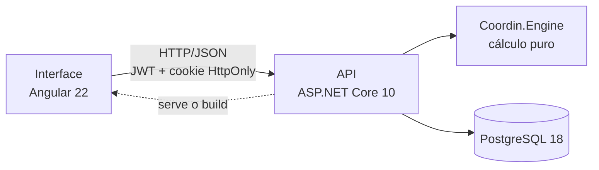

# Coordin

> Sistema de apoio à decisão que transforma demandas priorizadas, esforço estimado e capacidade dos times em **previsões de entrega**, compara sequências alternativas de execução e aponta ociosidade e sobrecarga.

🇧🇷 Português · 🇺🇸 [English](README.en.md)

---

## Demonstração

https://github.com/user-attachments/assets/0dc20095-0e77-4d43-aade-13679d41c452

*Vídeo sem áudio. Mostra o fluxo principal: cadastro, cronograma, relatório por time e cenários.*

---

## Sumário

- [Sobre o projeto](#sobre-o-projeto)
- [O problema](#o-problema)
- [Como funciona](#como-funciona)
- [Funcionalidades](#funcionalidades)
- [Regras de negócio](#regras-de-negócio)
- [Arquitetura](#arquitetura)
- [Tecnologias](#tecnologias)
- [Estrutura do repositório](#estrutura-do-repositório)
- [Como executar localmente](#como-executar-localmente)
- [Testes e verificações](#testes-e-verificações)
- [Implantação](#implantação)
- [Documentação do projeto](#documentação-do-projeto)
- [Status](#status)
- [Contribuição](#contribuição)
- [Contexto acadêmico](#contexto-acadêmico)
- [Licença](#licença)

---

## Sobre o projeto

O Coordin foi feito para o **gestor de desenvolvimento**, que precisa responder a uma pergunta ao gestor de produto com segurança:

> **"Quando cada demanda pode ser entregue, considerando a capacidade real dos times?"**

A partir das demandas, das estimativas dos times e da disponibilidade das pessoas, o sistema calcula:

- um **cronograma** com a data prevista de cada demanda, com e sem margem de segurança;
- o **relatório por time**, com ocupação, ociosidade e sobrecarga semana a semana;
- **cenários** de sequenciamento, com o impacto de cada alternativa;
- **recomendações** que o gestor pode aprovar ou rejeitar.

O princípio central: **o gestor decide; o sistema calcula, mostra o impacto e recomenda.**

## O problema

Planejar entregas fica difícil quando muitas demandas disputam atenção e vários times participam de cada uma. Algumas demandas envolvem um único time; outras exigem vários trabalhando juntos.

Dores comuns:

- Não há uma visão consolidada de demandas, responsáveis, esforço e datas previstas.
- O trabalho é mal distribuído: alguns times ficam ociosos enquanto outros estouram.
- É difícil entender o impacto de uma demanda nova sobre o cronograma existente.
- Comparar sequências alternativas para achar uma organização mais eficiente é trabalhoso e feito à mão.
- A previsão depende das estimativas dos times, e não só da prioridade.

O desafio não é só registrar tarefas. É **coordenar a capacidade de vários times** para prever e melhorar as entregas do setor.

## Como funciona

1. **Cadastros:** o gestor registra times, pessoas (com horas por dia útil), ausências e feriados do setor.
2. **Demandas:** cada demanda recebe título, data de início, times envolvidos, esforço estimado por time e pessoas alocadas. Uma demanda pode entrar sem estimativa ou sem data: o sistema a trata como **não previsível** até a informação chegar.
3. **Previsão:** o motor simula, dia a dia, o trabalho de cada pessoa na ordem de execução e calcula a data de término. Depois aplica a margem de segurança, que só amplia o prazo.
4. **Análise:** o cronograma e o relatório por time mostram a folga e a sobrecarga do setor.
5. **Decisão:** o sistema recomenda cenários de sequenciamento com o impacto de cada um. Nada muda sem a aprovação do gestor.

## Funcionalidades

### Cadastros
- **Times**, com nome único e capacidade calculada pela soma das pessoas.
- **Pessoas**, com horas por dia útil (de 0 a 24) e ausências.
- **Ausências** (férias ou outro tipo), com período de início e fim.
- **Feriados do setor**, que não contam como dia de trabalho.

### Demandas
- Cadastro com título, data de início, fim informado (opcional), times com esforço por time (opcional) e pessoas alocadas.
- **Ordem de prioridade** com Subir e Descer, sem arrastar.
- **Dependências** entre demandas, com bloqueio de ciclos e de exclusão de um pré-requisito que ainda tem dependentes.
- **Conclusão** com data e esforço real, que alimenta os indicadores de precisão.
- **Histórico** de alterações de estimativa e de previsão, com o motivo registrado.

### Cronograma e previsão
- Data prevista **sem margem** e **com margem**, com o motivo quando a demanda não é previsível (sem data, sem estimativa, sem capacidade ou com pré-requisito não previsível).
- **Margem de segurança** configurável (padrão de 20%), aplicada em dias úteis.
- **Exportação para planilha** (CSV em pt-BR, com as mesmas datas da tela).

### Relatório por time
- Capacidade, horas alocadas, ocupação e horas ociosas por semana (de segunda a domingo).
- **Sobrecarga**: a semana em que o time usou toda a capacidade e ainda ficou trabalho esperando.
- Mapa de ocupação e tabela com os mesmos valores do gráfico.

### Cenários de sequenciamento
- **Recomendações sob pedido:** o sistema busca sequências melhores que a atual e mostra o critério atual, o critério do cenário e a contribuição de cada demanda.
- **Simulação** de uma ordem específica, sem gravar nada.
- **Aprovação** com confirmação em dois passos, e **voltar à prioridade** a qualquer momento.
- A prioridade definida entre produto e desenvolvimento é preservada: a alternativa aparece como recomendação, nunca como substituição silenciosa.

### Simulação de demanda nova
- Mostra quais demandas existentes mudam de data se a nova demanda entrar na posição escolhida. Nada é gravado.

### Precisão e validação
- **Precisão das previsões:** indicadores comparando a previsão com a data e o esforço reais das demandas concluídas.
- **Validação por simulação:** ferramenta para testar o cálculo com um conjunto de dados fictício. Fica **desligada por padrão** e, quando ligada, substitui os dados do banco.

### Acesso
- Login do gestor com sessão de 15 minutos renovada automaticamente, bloqueio após 5 erros de senha e limite de requisições por IP.

## Regras de negócio

Estas regras valem para todo o sistema e só mudam com aprovação explícita do gestor de produto e do gestor de desenvolvimento.

1. **A margem de segurança nunca reduz o prazo.** Ela só pode ampliar a previsão.
2. **O sistema nunca reordena demandas sozinho.** Uma mudança de sequência é sempre um cenário com impacto, aguardando aprovação ou rejeição.
3. **A prioridade entre produto e desenvolvimento é preservada.** Alternativas são recomendações.
4. **Adicionar um time não divide o prazo pela metade.** A previsão considera a capacidade efetiva.
5. **Uma demanda pode não ter esforço.** Ela é aceita e tratada como não previsível até a estimativa chegar.

## Arquitetura

O cálculo fica isolado em uma biblioteca pura, sem banco, HTTP ou relógio do sistema. A API e a interface consomem o motor, e as regras de negócio não ficam espalhadas em controllers ou componentes.



- **`Coordin.Engine`**: previsão, margem, capacidade, cenários, simulação e indicadores. Entradas e saídas explícitas e resultado determinístico.
- **`Coordin.Api`**: endpoints, autenticação, persistência (EF Core), validação e exportação.
- **`coordin-web`**: interface, que também é servida pela própria API na mesma origem.

## Tecnologias

| Camada | Tecnologia |
|--------|------------|
| Linguagem e runtime | C# com .NET 10 (LTS) |
| API | ASP.NET Core Minimal APIs, Problem Details, OpenAPI |
| Persistência | EF Core 10 com Npgsql, PostgreSQL 18 |
| Autenticação | ASP.NET Core Identity, JWT de 15 minutos, refresh token em cookie `HttpOnly` com rotação |
| Motor de cálculo | `Coordin.Engine`, biblioteca em C# sem dependências de infraestrutura |
| Interface | Angular 22 (componentes standalone e signals), TypeScript 6, Tailwind CSS 4 |
| Gráficos | Chart.js 4.6 |
| Testes | xUnit v3, Testcontainers (PostgreSQL real), Vitest, Playwright |
| Qualidade | `dotnet format`, ESLint, Prettier, analisadores do .NET |
| Infraestrutura | Docker (uma imagem com a API e o build do Angular), Docker Compose, GitHub Actions |
| Hospedagem | Container em serviço de PaaS, com PostgreSQL gerenciado (ver [Implantação](#implantação)) |

As decisões técnicas e as alternativas consideradas estão em [`docs/TDD.md`](docs/TDD.md).

## Estrutura do repositório

```
coordin/
├── docs/                        # PRD, TDD, especificações e design
├── openspec/                    # specs vigentes e changes (SDD)
├── src/
│   ├── Coordin.Engine/          # motor de cálculo puro
│   ├── Coordin.Api/             # API ASP.NET Core
│   └── coordin-web/             # interface Angular
├── tests/
│   ├── Coordin.Engine.Tests/    # testes de unidade do motor
│   └── Coordin.Api.Tests/       # testes de integração da API
├── compose.yaml                 # PostgreSQL local e perfil de produção
├── Dockerfile                   # imagem única (API + interface)
└── .github/workflows/ci.yml     # CI: jobs .NET e web
```

## Como executar localmente

### Pré-requisitos

- [.NET SDK 10](https://dotnet.microsoft.com/download) (a versão exata está em `global.json`)
- [Node.js 24 LTS](https://nodejs.org) e npm
- [Docker](https://www.docker.com/products/docker-desktop/) (PostgreSQL local e testes de integração)

### Passo a passo

```bash
# 1. Clone o repositório
git clone https://github.com/pedrohenriquedsdev/coordin.git
cd coordin

# 2. Crie o .env local com a senha do banco (letras e números).
#    O .env é ignorado pelo Git. Nunca faça commit de senhas.
echo "POSTGRES_PASSWORD=SUA_SENHA" > .env

# 3. Suba o PostgreSQL
docker compose up -d

# 4. Configure os segredos da API com user secrets (fora do repositório).
#    A senha precisa ser a mesma do .env.
dotnet user-secrets set "ConnectionStrings:Default" "Host=localhost;Port=5432;Database=coordin;Username=coordin;Password=SUA_SENHA" --project src/Coordin.Api

# 5. Configure a autenticação (veja a seção "Autenticação" abaixo).
dotnet user-secrets set "Jwt:SigningKey" "UMA_CHAVE_ALEATORIA_COM_PELO_MENOS_32_BYTES" --project src/Coordin.Api
dotnet user-secrets set "Manager:Email" "voce@exemplo.com" --project src/Coordin.Api
dotnet user-secrets set "Manager:Password" "UMA_SENHA_COM_PELO_MENOS_12_CARACTERES" --project src/Coordin.Api

# 6. Rode a API na porta 5080. Ela aplica as migrations e cria a conta do gestor ao iniciar.
#    A API escuta na variável PORT (8080 se não definida), e o proxy do front espera a 5080:
#      PowerShell:  $env:PORT = "5080"
#      bash:        export PORT=5080
dotnet run --project src/Coordin.Api
```

Em um segundo terminal, rode a interface:

```bash
cd src/coordin-web
npm ci
npm start   # http://localhost:4200, com proxy de /api para a porta 5080
```

Abra `http://localhost:4200` e entre com o `Manager:Email` e o `Manager:Password` definidos no passo 5.

Com a API em `Development`, a documentação OpenAPI fica em `http://localhost:5080/openapi/v1.json` e a Swagger UI em `http://localhost:5080/swagger`. Para checar a conexão, acesse `http://localhost:4200/api/health`, que deve responder `{"status":"Healthy"}`. Se aparecer `ECONNREFUSED`, a API não está na porta 5080: confira se a variável `PORT` foi definida no mesmo terminal do `dotnet run`.

### Autenticação

Há uma única conta, a do gestor, e não existe tela de cadastro. A conta é criada na inicialização da API, a partir da configuração. Nenhuma credencial passa pelo repositório.

| Configuração | Variável de ambiente (produção) | O que é |
|--------------|---------------------------------|---------|
| `Jwt:SigningKey` | `Jwt__SigningKey` | Chave que assina os tokens de acesso. Pelo menos 32 bytes; sem ela a API não sobe. |
| `Manager:Email` | `Manager__Email` | E-mail da conta do gestor, criada se ainda não existir. |
| `Manager:Password` | `Manager__Password` | Senha da conta, com pelo menos 12 caracteres. |
| `Manager:ResetPassword` | `Manager__ResetPassword` | `true` troca a senha da conta existente (veja abaixo). |

`Jwt:Issuer` e `Jwt:Audience` não são segredos e ficam no `appsettings.json`.

Para gerar uma chave aleatória:

```bash
node -e "console.log(require('crypto').randomBytes(48).toString('base64'))"
```

**Como funciona a sessão:** o login devolve um token de acesso válido por 15 minutos, guardado só na memória do navegador (nunca no `localStorage`). A sessão é renovada em silêncio por um refresh token em cookie `HttpOnly`, válido por 7 dias e trocado a cada renovação. Recarregar a página mantém o login. Cinco senhas erradas bloqueiam a conta por 15 minutos, e login e renovação são limitados a 10 requisições por minuto por IP.

**Esqueceu a senha?** Defina `Manager:Password` com a nova senha e `Manager:ResetPassword` como `true`, reinicie a API e depois remova a flag `ResetPassword`. Isso também libera um bloqueio e encerra as sessões abertas. Só a senha muda, não o e-mail.

**Trocar `Jwt:SigningKey`** invalida os tokens de acesso já emitidos. O navegador os renova sozinho com o refresh token, então ninguém precisa entrar de novo.

Observações:
- O cookie de renovação é `Secure`. Chrome, Edge e Firefox aceitam em `http://localhost`; o Safari não, então use outro navegador no desenvolvimento local.
- Se rodar a API compilada diretamente (`dotnet bin/Debug/net10.0/Coordin.Api.dll`), faça-o a partir da pasta `src/Coordin.Api`, senão o `appsettings.json` não é encontrado e a API não sobe.

### Rodar a imagem de produção localmente

Além de `POSTGRES_PASSWORD`, a imagem precisa dos valores de autenticação, lidos do mesmo `.env`:

```bash
# .env
POSTGRES_PASSWORD=SUA_SENHA
JWT_SIGNING_KEY=UMA_CHAVE_ALEATORIA_COM_PELO_MENOS_32_BYTES
MANAGER_EMAIL=voce@exemplo.com
MANAGER_PASSWORD=UMA_SENHA_COM_PELO_MENOS_12_CARACTERES
```

```bash
docker compose --profile app up -d --build   # http://localhost:8080
docker compose --profile app down
```

A imagem roda como `Staging`, igual à produção, exceto pelo HTTPS obrigatório, que não se aplica localmente. Se o contêiner sair logo após subir, leia `docker compose logs app`: a falta de `JWT_SIGNING_KEY` aparece ali. Sem `MANAGER_EMAIL` e `MANAGER_PASSWORD` a aplicação sobe, mas ninguém consegue entrar. O `docker compose up -d` comum (só o banco) não precisa desses valores.

### Gerar o cliente tipado da API

Com a API rodando em `Development`, dentro de `src/coordin-web`:

```bash
npm run generate:api
```

O código gerado em `src/coordin-web/src/app/api/` fica no repositório, então uma mudança de contrato aparece no diff do pull request.

## Testes e verificações

```bash
# .NET: build, formatação e testes (o Docker precisa estar rodando: os testes de integração sobem um PostgreSQL)
dotnet build Coordin.slnx
dotnet format Coordin.slnx --verify-no-changes
dotnet test Coordin.slnx

# Interface (dentro de src/coordin-web)
npm run lint
npm test
npm run build
```

- **Motor de cálculo:** testes de unidade cobrindo os casos de borda (esforço zero ou ausente, time sem capacidade, ausência no meio do período, várias equipes na mesma demanda, dependência em cadeia, ciclo de dependência, margem aplicada e arredondada para cima). Há também testes de propriedade sobre centenas de cenários gerados com semente fixa.
- **API:** testes de integração contra PostgreSQL real.
- **Interface:** testes unitários que rodam em mais de um fuso horário, para garantir que datas de calendário não mudem de dia.
- **Ponta a ponta:** três cenários de fumaça com Playwright (login, do cadastro à previsão, e o cronograma em 360 px). Eles sobem uma pilha descartável com o próprio banco de teste. Rodam localmente, fora da CI:

  ```bash
  # dentro de src/coordin-web, com Docker e o Google Chrome instalados
  npm run test:e2e
  ```

O pipeline de integração contínua (`.github/workflows/ci.yml`) roda os jobs `dotnet` (build, formatação, testes e testes de desempenho) e `web` (lint, testes, build) em todo pull request e push para a `main`.

## Implantação

O roteiro completo, com os limites das plataformas gratuitas e a verificação ponta a ponta, está em [`docs/deployment.md`](docs/deployment.md). O `render.yaml` descreve o serviço, e o banco fica em um PostgreSQL gerenciado.

## Documentação do projeto

| Documento | Conteúdo |
|-----------|----------|
| [`docs/PRD.md`](docs/PRD.md) | Problema, personas, requisitos (MoSCoW), critérios de aceite, métricas e escopo |
| [`docs/TDD.md`](docs/TDD.md) | Arquitetura, stack, modelo de dados, contratos, algoritmos e estratégia de testes |
| [`docs/design/`](docs/design/) | Modelo entidade-relacionamento, protótipos e especificações consolidadas |
| [`openspec/specs/`](openspec/specs/) | Comportamento vigente do sistema, fonte da verdade |
| [`docs/deployment.md`](docs/deployment.md) | Implantação e verificação em produção |

O fluxo de desenvolvimento segue **PRD → TDD → SDD (OpenSpec) → Pull Request**, com cada requisito rastreável por um identificador (`RF-*`, `RNF-*`, `DT-*`).

## Status

Sistema em produção, com todas as funcionalidades do escopo planejado implementadas (changes 1 a 13 do roadmap do TDD).

## Contribuição

Este é um projeto proprietário. Contribuições externas acontecem somente por convite do autor. Se você quiser sugerir algo, abra uma *issue* para discutir antes.

## Contexto acadêmico

O Coordin nasceu como proposta de Trabalho de Conclusão de Curso: *Planejamento e otimização de demandas, um sistema de apoio à previsão de entregas e à distribuição da capacidade dos times de desenvolvimento.* O gestor continua responsável pelas decisões; o sistema oferece os cálculos, a visibilidade e os cenários necessários para tomá-las.

## Licença

**Proprietária. Todos os direitos reservados.** Copyright © 2026 Pedro Henrique dos Santos. O software e o código-fonte não podem ser usados, copiados, modificados ou distribuídos sem autorização prévia por escrito. Veja o arquivo [`LICENSE`](LICENSE).
