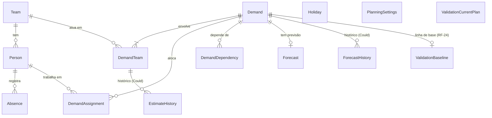

# TDD — Coordin

- **Status:** aprovado (2026-11-11); hospedagem (DT-09) decidida em 2026-11-12, com o provedor escolhido na change 7. Ajuste em 2026-11-11: gráficos e justificativa dos cenários (DT-36), decorrentes dos ajustes do PRD em RF-13, RF-17 e RF-23. Ajuste em 2026-11-12, decorrente do PRD: RF-17 como Must no roadmap, validação por simulação no produto (RF-24, DT-37) e roadmap com 13 changes. Ajuste em 2026-11-12, na change 1: endpoint de saúde `GET /api/health` (seção 5.2)
- **Última atualização:** 2026-11-12
- **Fontes:** [`docs/PRD.md`](PRD.md) (aprovado em 2026-11-10) · [`docs/references/tcc-proposal.pdf`](references/tcc-proposal.pdf)

---

## 1. Contexto e objetivos técnicos

### 1.1 Resumo do produto

O Coordin é um sistema de planejamento e apoio à decisão para o gestor de desenvolvimento, seu **único usuário**. Ele transforma demandas priorizadas, esforço estimado em horas e capacidade dos times em previsões de entrega, compara sequências alternativas de execução e aponta ociosidade e sobrecarga. O gestor sempre decide; o sistema calcula, mostra o impacto e recomenda.

O PRD define 24 requisitos funcionais (Must RF-01 a RF-12 e RF-17; Should RF-13 a RF-16, RF-18 e RF-19; Could RF-20 a RF-23; apoio à validação RF-24), 8 não funcionais (RNF-01 a RNF-08) e 5 regras invioláveis (PRD 6.1). Este documento define **como** atendê-los.

### 1.2 Objetivos técnicos

| # | Objetivo | Origem |
|---|---|---|
| OT-1 | **Cálculo correto e determinístico:** previsão, margem, paralelismo, dependências, ociosidade/sobrecarga e cenários ficam em um motor de cálculo isolado, sem banco, HTTP ou interface, com entradas e saídas explícitas e sem relógio ou aleatoriedade não injetados. | RNF-02, RNF-08; `CLAUDE.md` §8.1 |
| OT-2 | **Regras invioláveis garantidas pelo motor,** e não pela interface: nenhum caminho de código pode reduzir o prazo pela margem, reordenar demandas sem aprovação ou dividir o prazo pelo número de times. | PRD 6.1 |
| OT-3 | **Recálculo rápido:** com 15 times, 150 pessoas e 200 demandas, cronograma em até 2 s e cenários recomendados em até 10 s. | RNF-01 |
| OT-4 | **Acesso pela rede, no navegador:** aplicação web hospedada, completa no computador e de consulta no celular (telas a partir de 360 px). | RNF-03; PRD R-02, R-08 |
| OT-5 | **Acesso protegido e dados mínimos:** login do gestor, senhas nunca em texto puro, apenas os dados pessoais necessários e nenhum dado real ou segredo no repositório. | RNF-04, RNF-05 |
| OT-6 | **Persistência confiável:** toda alteração confirmada sobrevive entre sessões e dispositivos. | RNF-06 |
| OT-7 | **Interface em português do Brasil,** com esforço e capacidade em horas e datas no fuso `America/Sao_Paulo`. | RNF-07 |
| OT-8 | **Entrega incremental:** cada change do OpenSpec entrega um conjunto de requisitos utilizável e testado, na ordem Must → Should → Could. | PRD 8.1, 10 |

### 1.3 Restrições

- **Prazo:** entrega em 2026-11-28. Marcos do PRD: TDD aprovado até 2026-11-13 (M3), Must até 2026-11-21 (M4), Should até 2026-11-24 (M5), congelamento em 2026-11-25 (M6), validação por simulação em 2026-11-26 (M7). Toda decisão técnica favorece o que pode ser entregue e testado nesse prazo.
- **Usuário único:** um gestor e um planejamento; sem perfis, permissões por papel ou multi-inquilino (PRD 8.2).
- **Sem integrações nem notificações:** dados entram pelo próprio sistema; a única saída é a exportação em planilha (RF-19).
- **Stack:** a preferência é C#/.NET (`CLAUDE.md` §8.1), a confirmar na seção 3; versões e compatibilidade verificadas em documentação oficial.
- **Volume pequeno e conhecido:** até 15 times, 150 pessoas e 200 demandas (RNF-01), o que permite manter o planejamento inteiro em memória durante o cálculo.

### 1.4 Onde cada decisão delegada pelo PRD é fechada

| PRD 9.3 | Decisão | Seção do TDD |
|---|---|---|
| 1 | Modelo de capacidade e calendário | 4 (dados) e 6 (cálculo) |
| 2 | Paralelismo entre times | 6 |
| 3 | Representação de dependências e detecção de ciclos | 4 e 6 |
| 4 | Margem de segurança: tipo, etapa e unidade de arredondamento | 6 |
| 5 | Critério e método de otimização dos cenários | 6 |
| 6 | Registro de mudanças e previsto × realizado | 4 e 6 |
| 7 | Tamanho do período do relatório por time | 6 |
| 8 | Formato do arquivo exportado | 5 |
| 9 | Stack, autenticação e hospedagem | 3 e 7 |

---

## 2. Arquitetura

### 2.1 Visão geral

```
┌──────────────────────── Navegador (computador / celular) ───────────────────────┐
│  coordin-web (Angular SPA)                                                      │
└───────────────────────────────┬─────────────────────────────────────────────────┘
                                │ HTTPS · JSON · mesma origem
┌───────────────────────────────▼─────────────────────────────────────────────────┐
│  Coordin.Api (ASP.NET Core) — um único container                                │
│   • serve os arquivos estáticos do Angular                                      │
│   • endpoints HTTP, autenticação, validação de entrada, exportação              │
│   • persistência (EF Core) e mapeamento banco ⇄ motor                           │
│                      │ chama, passando um snapshot do planejamento              │
│   ┌──────────────────▼───────────────────┐                                      │
│   │ Coordin.Engine (biblioteca C# pura)  │  sem banco, HTTP, relógio ou I/O     │
│   │ previsão · margem · paralelismo ·    │                                      │
│   │ dependências · relatórios · cenários │                                      │
│   └──────────────────────────────────────┘                                      │
└───────────────────────────────┬─────────────────────────────────────────────────┘
                                │
                     ┌──────────▼──────────┐
                     │ PostgreSQL          │
                     └─────────────────────┘
```

| Componente | Responsabilidade | Não faz |
|---|---|---|
| `coordin-web` | Telas, navegação, formulários, apresentação do cronograma e dos relatórios; layout de consulta no celular | Nenhum cálculo de previsão ou regra de negócio |
| `Coordin.Api` | Endpoints, autenticação, validação de entrada, persistência, montagem do snapshot para o motor, gravação dos resultados, exportação em planilha | Nenhuma regra de cálculo |
| `Coordin.Engine` | Todas as regras de cálculo e as regras invioláveis, como funções determinísticas sobre entradas explícitas | Acesso a banco, rede, arquivos ou relógio do sistema |
| PostgreSQL | Armazenamento persistente | — |

### 2.2 Decisões

#### DT-01 — Monólito modular em uma única unidade de implantação

- **Contexto:** um usuário, volume pequeno (RNF-01), prazo curto e necessidade de acesso pela rede (RNF-03).
- **Alternativas consideradas:**
  - *Monólito modular (API + SPA servida pela própria API, em um container):* um deploy, mesma origem (sem CORS e com cookie de sessão simples), menos infraestrutura; front e back continuam separados no código.
  - *Front e API implantados separadamente:* escala e deploy independentes, mas exige CORS, dois deploys e configuração de domínio, sem benefício para um usuário.
  - *Microsserviços:* complexidade operacional injustificável para o escopo e o prazo.
- **Decisão:** monólito modular. A API ASP.NET Core serve o build estático do Angular e expõe os endpoints sob `/api`.
- **Justificativa:** menor custo de implantação e de segurança para o prazo; a separação de responsabilidades fica nos projetos (DT-02, DT-04), não na infraestrutura. Se um dia for preciso separar, o front já é uma SPA independente.
- **Atende:** RNF-03, RNF-04, RNF-06.

#### DT-02 — Motor de cálculo como biblioteca pura sobre um snapshot do planejamento

- **Contexto:** o cálculo concentra as regras invioláveis e os casos de borda que exigem testes (RNF-02, RNF-08; `CLAUDE.md` §8.1).
- **Alternativas consideradas:**
  - *Biblioteca pura com modelo próprio de entrada e saída:* a API monta um snapshot imutável (times, pessoas, capacidade, ausências, demandas, alocações, dependências, ordem de execução, parâmetros de margem e a data de referência) e recebe o resultado; testável sem banco e determinístico por construção.
  - *Regras nas entidades do EF Core ou em serviços da API:* menos mapeamento, mas acopla cálculo a banco e HTTP e dificulta testar.
- **Decisão:** biblioteca `Coordin.Engine` sem dependências externas de pacotes, com tipos de entrada e saída imutáveis (`record`s). A data de referência ("hoje") é sempre um parâmetro de entrada, nunca lida do relógio.
- **Justificativa:** isola o que mais importa testar; o custo é manter um mapeamento entre as entidades persistidas e o snapshot, aceito pelo ganho em testabilidade. O volume pequeno (até 200 demandas) permite recalcular o planejamento inteiro a cada vez, sem cálculo incremental.
- **Atende:** RF-08 a RF-10, RF-13, RF-17, RF-18, RNF-01, RNF-02, RNF-08; regras invioláveis 1 a 5.

#### DT-03 — Recalcular na escrita e persistir o resultado

- **Contexto:** o RF-12 exige guardar a primeira previsão de cada demanda, o RF-21 o histórico das previsões, e o RNF-01 limita o tempo de resposta.
- **Alternativas consideradas:**
  - *Recalcular a cada alteração e persistir as previsões:* toda escrita (cadastro, estimativa, ausência, alocação, ordem, aprovação de cenário) dispara o motor na mesma requisição e grava as previsões vigentes; a primeira previsão de cada demanda é gravada uma vez e nunca alterada. Leituras são rápidas e consistentes.
  - *Calcular só na leitura, sem persistir:* mais simples, mas não preserva a primeira previsão nem o histórico.
- **Decisão:** recalcular na escrita, dentro da mesma transação, e persistir as previsões vigentes. Simulações (RF-14, RF-16) e cenários recomendados (RF-13) chamam o motor sem persistir até a aprovação (RF-15) ou a confirmação.
- **Justificativa:** garante a linha de base do RF-12 e o histórico do RF-21 com a mesma estrutura; o custo de recalcular tudo é baixo no volume do RNF-01.
- **Atende:** RF-08, RF-12, RF-15, RF-16, RF-21, RNF-01, RNF-06.

#### DT-04 — Estrutura do repositório

- **Contexto:** o `CLAUDE.md` §3 adia a estrutura de código para o TDD.
- **Alternativas consideradas:**
  - *Monorepo com `src/` e `tests/`:* um repositório, uma branch por change, PRs que tocam front e back juntos.
  - *Repositórios separados para front e back:* PRs e versões desalinhados para uma mesma funcionalidade.
- **Decisão:** monorepo com a estrutura:

```
coordin/
├── src/
│   ├── Coordin.Engine/            # biblioteca pura de cálculo
│   ├── Coordin.Api/               # ASP.NET Core: endpoints, auth, persistência, export
│   └── coordin-web/               # Angular SPA
├── tests/
│   ├── Coordin.Engine.Tests/      # testes de unidade do motor (obrigatórios)
│   └── Coordin.Api.Tests/         # testes de integração da API
├── Coordin.slnx                   # solução .NET
├── compose.yaml                   # PostgreSQL para desenvolvimento local
├── Dockerfile                     # imagem única: API + build do Angular
├── docs/ · openspec/ · .github/ · .claude/
```

- **Justificativa:** cada change do OpenSpec entrega uma fatia vertical (motor, API e tela) em um único PR; o motor fica fisicamente separado, o que impede dependências acidentais de banco ou HTTP.
- **Atende:** `CLAUDE.md` §3 e §8.1.

---

## 3. Stack

Versões estáveis verificadas em 2026-11-11 nos registros oficiais (NuGet, npm) e na documentação oficial; as versões exatas são travadas no scaffold (arquivos de projeto e `package-lock.json`).

| Camada | Tecnologia | Versão |
|---|---|---|
| Runtime e linguagem | .NET 10 (LTS), C# 14 | SDK 10.0.4xx (instalado: 10.0.403) |
| API | ASP.NET Core 10, Minimal APIs, Problem Details | 10.0.x |
| Autenticação | ASP.NET Core Identity + JWT Bearer (DT-28) | Microsoft.AspNetCore.Identity.EntityFrameworkCore 10.0.15 · Microsoft.AspNetCore.Authentication.JwtBearer 10.0.15 |
| Documento OpenAPI | Microsoft.AspNetCore.OpenApi (DT-19) | 10.0.15 |
| Documentação interativa (só em desenvolvimento) | Swashbuckle.AspNetCore.SwaggerUI (DT-19) | 11.0.x (compatível com `net10.0`) |
| Cliente Angular gerado | ng-openapi-gen (DT-19) | 1.1.x |
| Persistência | EF Core 10 + Npgsql | EF Core 10.0.15 · Npgsql.EntityFrameworkCore.PostgreSQL 10.0.3 |
| Banco | PostgreSQL | 18 |
| Front | Angular (componentes standalone, signals) | 22.2.x (CLI 22.2.6) |
| Linguagem do front | TypeScript | **6.0.x** (o Angular 22 exige `>=6.0 <6.1`; não usar o TypeScript 7) |
| Estilos | Tailwind CSS | 4.3.x |
| Gráficos | Chart.js (DT-36), usado diretamente, sem wrapper | 4.6.x |
| Runtime do front (build) | Node.js | 24 LTS (instalado: 24.21; o Angular 22 exige `^24.15`) |
| Testes .NET | xUnit v3 | 3.2.x |
| Testes front | Vitest (suportado pelo builder do Angular 22) | 5.x |
| Testes de integração, E2E e cobertura (seção 8) | Testcontainers.PostgreSql · Microsoft.AspNetCore.Mvc.Testing · Playwright · coverlet.collector | 4.16.x · 10.0.15 · 1.65.x · 10.x |
| Qualidade | `dotnet format`; ESLint (angular-eslint 22.x); Prettier 3.x | — |
| Ambiente local | Docker + Docker Compose (PostgreSQL) | Docker 29 (instalado) |

#### DT-05 — .NET 10 LTS agora; .NET 11 como atualização pendente

- **Contexto:** a preferência é C#/.NET na versão mais recente. O .NET 11 (STS) saiu em 2026-11-10 com EF Core 11 estável, mas o provedor PostgreSQL para EF Core 11 (Npgsql 11) ainda estava em release candidate (`11.0.0-rc.3`) em 2026-11-11.
- **Alternativas consideradas:**
  - *.NET 10 LTS:* tudo estável e já instalado; suporte até 2028-11; abre mão das novidades do .NET 11.
  - *.NET 11 com Npgsql RC:* versão mais nova, com risco de dependência de pré-lançamento na entrega.
  - *.NET 11 com EF Core 10 e Npgsql 10:* runtime novo com acesso a dados estável, mas mistura de versões principais.
- **Decisão:** .NET 10 LTS em todo o back-end. A atualização para o .NET 11 fica como pendência (seção 10), a fazer **somente** se sobrar tempo depois dos Should e com o Npgsql 11 estável publicado.
- **Justificativa:** a entrega não pode depender de pré-lançamento; a atualização entre versões principais do .NET costuma se limitar ao target framework e aos pacotes, e os testes do motor (RNF-08) validam a troca.
- **Atende:** RNF-01, RNF-06; restrição de prazo (1.3).

#### DT-06 — ASP.NET Core Minimal APIs com Problem Details

- **Contexto:** a API é consumida apenas pela SPA e tem poucas dezenas de endpoints.
- **Alternativas consideradas:**
  - *Minimal APIs agrupadas por recurso (`MapGroup`):* menos cerimônia, endpoints próximos da funcionalidade, bom suporte a validação, OpenAPI e Problem Details.
  - *Controllers MVC:* estrutura conhecida, mais código repetitivo para o mesmo resultado.
- **Decisão:** Minimal APIs agrupadas por recurso; erros no formato **Problem Details** (RFC 9457), com mensagens em português para o usuário.
- **Justificativa:** menos código para o prazo e um formato de erro padronizado que o front trata de um jeito só (critérios do PRD que exigem "mensagem clara", como RF-06 e RF-18).
- **Atende:** RF-06, RF-18, RNF-07.

#### DT-07 — PostgreSQL com EF Core

- **Contexto:** persistência entre sessões e dispositivos (RNF-06) e hospedagem acessível pela rede.
- **Alternativas consideradas:**
  - *PostgreSQL:* gratuito, robusto, disponível como serviço gerenciado na maioria das hospedagens e em Docker localmente.
  - *SQLite:* zero configuração, mas exige disco persistente na hospedagem.
  - *SQL Server:* integração nativa com .NET, mas opções gerenciadas gratuitas mais limitadas e imagem Docker pesada.
- **Decisão:** PostgreSQL 18, acessado com EF Core 10 e Npgsql 10; esquema versionado por migrations do EF Core; PostgreSQL local via Docker Compose.
- **Justificativa:** mesmo banco em desenvolvimento e produção, sem dependência da hospedagem escolhida.
- **Atende:** RNF-06.

#### DT-08 — Angular 22 + TypeScript 6.0 + Tailwind CSS

- **Contexto:** interface completa no computador e de consulta no celular (RNF-03); preferência por combinar C# com outras tecnologias.
- **Alternativas consideradas:**
  - *Angular + TypeScript:* framework completo e opinativo (roteamento, formulários, HTTP, signals) e tipagem forte; combina C# no back com TypeScript no front.
  - *React + TypeScript:* maior ecossistema de componentes, mais escolhas de bibliotecas a fazer.
  - *Blazor:* tudo em C#, com menos ecossistema de componentes de cronograma.
- **Decisão:** Angular 22 com componentes standalone e signals, TypeScript 6.0.x e Tailwind CSS 4 para o layout responsivo. Sem biblioteca de componentes visuais: os componentes são próprios, estilizados com Tailwind.
- **Justificativa:** escolha do autor; o Angular traz pronto o que o PRD exige (formulários com validação, roteamento, cliente HTTP), e o Tailwind agiliza o layout do computador e do celular sem uma biblioteca de componentes pesada.
- **Atende:** RNF-03, RNF-07.

#### DT-36 — Gráficos com Chart.js em um componente próprio

- **Contexto:** os cenários precisam mostrar por que são melhores, e o relatório por time e os indicadores precisam ser apresentados em gráfico, sempre com uma tabela dos mesmos valores (RF-13, RF-14, RF-17, RF-23). Os dados já são calculados pelo motor em milissegundos (DT-02, DT-03), então os gráficos são desenhados na tela a partir das respostas da API, sem processamento assíncrono nem geração de arquivo.
- **Alternativas consideradas** (versões verificadas no npm em 2026-11-11):
  - *Chart.js 4.6.x usado diretamente, em um componente standalone próprio:* leve, tipos inclusos, licença MIT; barras agrupadas, empilhadas e flutuantes cobrem os três gráficos; exige um componente pequeno de integração com o `<canvas>`.
  - *Chart.js com ng2-charts 11.0.0:* diretiva pronta para o Angular 22, mas traz o `@angular/cdk` como dependência adicional e mais uma camada para atualizar.
  - *ECharts 6.1.0 com ngx-echarts 22.0.0:* mais recursos e interações, com pacote bem maior, pior para o celular (RNF-03).
  - *SVG próprio estilizado com Tailwind:* nenhuma dependência, mas eixos, escalas e responsividade feitos à mão, caro para o prazo.
- **Decisão:** `chart.js` 4.6.x, com os componentes registrados individualmente (sem `chart.js/auto`), envolvido por um componente standalone `ChartComponent` que recebe a configuração por `input()`, cria o gráfico no `<canvas>` obtido por `viewChild()`, atualiza-o em um `effect()` e o destrói ao sair da tela. Cada tela transforma a resposta da API em séries do gráfico por funções puras, testadas com Vitest. Todo gráfico tem ao lado, ou alternável com ele, uma tabela com os mesmos valores. Gráficos previstos:
  - **cenário (RF-13, RF-14):** data prevista de cada demanda antes e depois (barras flutuantes) e o `score` atual × do cenário, com as demandas que mais contribuem para a diferença;
  - **relatório por time (RF-17):** capacidade × horas alocadas por semana, com ociosidade e sobrecarga destacadas;
  - **indicadores (RF-23):** desvio médio e percentual no prazo por time, com a referência do setor.
- **Justificativa:** o Chart.js não é uma biblioteca de componentes visuais, então o DT-08 continua valendo: as telas seguem com componentes próprios e Tailwind, e só o desenho do gráfico é delegado. O componente próprio evita dependência extra e mantém a regra de negócio fora do front: os números (inclusive as parcelas do `score`) vêm do motor; o front só ordena e desenha. A tabela torna os valores verificáveis em teste e legíveis no celular.
- **Atende:** RF-13, RF-14, RF-17, RF-23; RNF-03.

#### DT-09 — Hospedagem: container Docker em PaaS com PostgreSQL gerenciado

- **Contexto:** o acesso pelo computador e pelo celular exige o sistema acessível pela rede (RNF-03, PRD R-02). O marco M4 (2026-11-21) exige os Must acessíveis pela rede.
- **Alternativas consideradas:**
  - *Container Docker em PaaS* (por exemplo, Render, Railway ou Fly.io) com PostgreSQL gerenciado: implanta a imagem única do DT-01, independe da versão do .NET.
  - *Azure App Service:* ecossistema Microsoft, possível crédito de estudante.
  - *Servidor virtual próprio:* mais controle, mais configuração e manutenção.
- **Decisão:** container Docker em PaaS com PostgreSQL gerenciado, validado com o professor orientador em 2026-11-12. O provedor (Render, Railway ou Fly.io) é escolhido na change 7 (`deployment`), depois de verificar planos, limites e suporte a Docker e PostgreSQL na documentação oficial de cada um.
- **Justificativa:** a mesma imagem Docker usada localmente (DT-01) é implantada sem adaptação; HTTPS, banco e backups ficam a cargo do provedor; nenhuma change antes da 7 depende do provedor, porque o Dockerfile da change 1 serve a qualquer PaaS.
- **Atende:** RNF-03, RNF-06.

---

## 4. Modelo de dados

### 4.1 Diagrama



### 4.2 Entidades

Tipos: identificadores `Guid` versão 7 (`uuid`); datas de planejamento `DateOnly` (`date`); instantes `DateTimeOffset` gravados em UTC (`timestamptz`) e exibidos no fuso `America/Sao_Paulo`; horas `decimal` com duas casas.

| Entidade | Atributos principais | Regras de integridade | Requisitos |
|---|---|---|---|
| `Team` | `Id`, `Name` | `Name` obrigatório e único (sem diferenciar maiúsculas) | RF-01 |
| `Person` | `Id`, `Name`, `TeamId`, `DailyCapacityHours` | Um único time (FK obrigatória); `DailyCapacityHours` entre 0 e 24 | RF-02 |
| `Absence` | `Id`, `PersonId`, `Type` (`Vacation`, `Other`), `StartDate`, `EndDate` | `EndDate >= StartDate`; sem motivo detalhado (RNF-05) | RF-03 |
| `Holiday` | `Id`, `Date`, `Description` (opcional) | `Date` única | RF-03 |
| `Demand` | `Id`, `Title`, `PriorityRank`, `ExecutionRank`, `StartDate` (opcional), `InformedEndDate` (opcional), `CompletedOn` (opcional), `ActualEffortHours` (opcional, Could) | `PriorityRank` e `ExecutionRank` únicos e contínuos a partir de 1; `CompletedOn >= StartDate`; `ActualEffortHours > 0` quando informado | RF-04, RF-07, RF-12, RF-22 |
| `DemandTeam` | `DemandId`, `TeamId`, `EstimatedEffortHours` (opcional) | Chave (`DemandId`, `TeamId`); `EstimatedEffortHours > 0` quando informado | RF-05, RF-06 |
| `DemandAssignment` | `DemandId`, `PersonId` | Chave (`DemandId`, `PersonId`); o time da pessoa precisa estar entre os times da demanda | RF-05 |
| `DemandDependency` | `DemandId`, `PrerequisiteDemandId` | Chave composta; sem autodependência; ciclos rejeitados pela API usando o motor (seção 6) | RF-18 |
| `Forecast` | `DemandId`, `IsPredictable`, `UnpredictableReason`, `ForecastStartDate`, `EndDateWithoutMargin`, `ForecastEndDate`, `BaselineEndDate`, `CalculatedAt` | Uma por demanda; `ForecastEndDate >= EndDateWithoutMargin`; `BaselineEndDate` gravada uma única vez | RF-08 a RF-12 |
| `ForecastHistory` | `Id`, `DemandId`, `PreviousEndDate`, `NewEndDate`, `Cause`, `ChangedAt` | Somente inclusão | RF-21 (Could) |
| `EstimateHistory` | `Id`, `DemandId`, `TeamId`, `PreviousHours`, `NewHours`, `Reason` (opcional), `ChangedAt` | Somente inclusão | RF-20 (Could) |
| `PlanningSettings` | `ExecutionOrderMode` (`FollowPriority`, `Custom`) e os parâmetros da margem de segurança (definidos na seção 6) | Registro único | RF-09, RF-15 |
| `ValidationBaseline` | `DemandId`, `BaselineDate` | Uma por demanda; apagada com a demanda e ao carregar o conjunto | RF-24 |
| `ValidationCurrentPlan` | `Id`, `SnapshotJson` (`jsonb`), `CapturedAt` | Registro único; gravado uma vez e só apagado ao carregar o conjunto de novo | RF-24 |

A conta de acesso do gestor usa as tabelas padrão do ASP.NET Core Identity (`AspNetUsers` e relacionadas) e a entidade `RefreshToken` (`Id`, `UserId`, `TokenHash`, `ExpiresAt`, `RevokedAt`, `ReplacedById`), detalhadas na seção 7 (DT-28). Cenários (RF-13, RF-14) e a simulação de nova demanda (RF-16) **não são persistidos** (DT-03): apenas o resultado aprovado altera `ExecutionRank` ou cria a demanda.

### 4.3 Decisões

#### DT-10 — Capacidade em horas por dia útil, com calendário do setor

- **Contexto:** modelo de capacidade delegado pelo PRD (9.3, item 1; `CLAUDE.md` §7.3), incluindo ausências, outras alocações e calendário.
- **Alternativas consideradas:**
  - *Horas por dia útil, um número por pessoa:* simples de cadastrar e de calcular; outras alocações da pessoa já ficam descontadas no número informado; não representa jornadas irregulares.
  - *Horas por dia da semana:* cobre jornadas irregulares, com mais cadastro e cálculo.
- **Decisão:** cada pessoa tem `DailyCapacityHours`. A capacidade de uma pessoa em uma data é `DailyCapacityHours` se a data for de segunda a sexta, não for feriado (`Holiday`) e não estiver em uma ausência da pessoa (`Absence`); caso contrário, zero. A capacidade de um time em uma data é a soma das capacidades das pessoas dele.
- **Justificativa:** atende ao RF-02 e ao RF-03 com o menor modelo possível. Feriados foram incluídos no PRD (RF-03, ajuste aprovado em 2026-11-11) para não tratar feriado como dia de trabalho.
- **Atende:** RF-02, RF-03, RF-08, RF-17.

#### DT-11 — Esforço estimado por time da demanda

- **Contexto:** paralelismo entre times (PRD 9.3, item 2) e a regra inviolável 4 (adicionar um time não divide o prazo automaticamente).
- **Alternativas consideradas:**
  - *Esforço por demanda × time (`DemandTeam.EstimatedEffortHours`):* cada time estima a sua parte; cada parte é executada com a capacidade do próprio time e a demanda termina quando a última parte termina. O paralelismo é explícito nos dados.
  - *Esforço total dividido pelo motor:* um número por demanda, repartido pela capacidade; exige um fator de eficiência para não virar divisão exata.
- **Decisão:** esforço por demanda × time. O esforço total da demanda é a soma das partes. A demanda só é previsível quando todos os times alocados têm estimativa.
- **Justificativa:** fiel a "os times informam o esforço" e garante a regra 4 por construção, sem um fator arbitrário. O PRD foi ajustado em RF-06 e RF-10 (aprovado em 2026-11-11).
- **Atende:** RF-05, RF-06, RF-08, RF-10; regra inviolável 4.

#### DT-12 — Alocação de pessoas inteiras, em fila por ordem de execução

- **Contexto:** RF-05 exige alocar pessoas às demandas e compartilhar a capacidade respeitando a ordem de execução.
- **Alternativas consideradas:**
  - *Pessoa inteira em fila:* cada pessoa trabalha nas demandas a que está alocada uma de cada vez, na ordem de execução; uma demanda posterior só recebe horas da pessoa quando as anteriores não precisarem mais dela.
  - *Percentual da pessoa por demanda:* mais flexível, com mais dados e risco de ultrapassar 100%.
  - *Só o time, sem pessoas:* mais simples, mas contraria o RF-05.
- **Decisão:** `DemandAssignment` liga pessoa e demanda, sem percentual. A parte de um time na demanda é executada pelas pessoas desse time alocadas a ela. Uma parte sem pessoas alocadas torna a demanda não previsível ("sem capacidade", RF-10).
- **Justificativa:** respeita o RF-05 e o RF-08 (demanda posterior não toma capacidade de anterior) com um modelo simples; o algoritmo da fila é detalhado na seção 6.
- **Atende:** RF-05, RF-08, RF-10.

#### DT-13 — Ordem de prioridade e ordem de execução separadas

- **Contexto:** RF-04 e RF-15 exigem preservar a prioridade registrada e permitir uma ordem de execução aprovada diferente (regras invioláveis 2 e 3).
- **Alternativas consideradas:**
  - *Dois rankings na demanda (`PriorityRank`, `ExecutionRank`) e um modo global:* com `FollowPriority`, o motor usa a prioridade; com `Custom`, usa a ordem aprovada. Voltar à prioridade (RF-15) é trocar o modo.
  - *Um único ranking:* aprovar cenário apagaria a prioridade combinada com o produto.
- **Decisão:** dois rankings mais `PlanningSettings.ExecutionOrderMode`. Aprovar um cenário grava o `ExecutionRank` de todas as demandas e muda o modo para `Custom`. No modo `Custom`, uma nova demanda entra no fim da ordem de execução, e o cronograma sinaliza a divergência em relação à prioridade (RF-15).
- **Justificativa:** a prioridade nunca é sobrescrita por uma decisão de sequência, e a divergência fica visível.
- **Atende:** RF-04, RF-11, RF-15; regras invioláveis 2 e 3.

#### DT-14 — Linha de base e históricos somente de inclusão

- **Contexto:** registro de mudanças e previsto × realizado (PRD 9.3, item 6).
- **Alternativas consideradas:**
  - *Linha de base como coluna gravada uma vez e históricos em tabelas somente de inclusão:* simples de consultar e impossível de "corrigir" por engano.
  - *Versionar o planejamento inteiro a cada alteração:* reconstrói qualquer momento, mas é desproporcional ao escopo.
- **Decisão:** `Forecast.BaselineEndDate` é gravada no primeiro cálculo em que a demanda se torna previsível e nunca é alterada. `ForecastHistory` e `EstimateHistory` (Could) só recebem inclusões; a API não expõe edição nem exclusão delas.
- **Justificativa:** atende ao RF-12 nos Must sem depender dos Could; os históricos podem ser implementados depois sem mudar o restante do modelo.
- **Atende:** RF-12, RF-20, RF-21, RF-23.

#### DT-15 — Identificadores e tipos de dados

- **Contexto:** consistência entre banco, API e motor; datas sem fuso para o planejamento e instantes com fuso para auditoria (RNF-07).
- **Alternativas consideradas:**
  - *`Guid` v7, `DateOnly` e `DateTimeOffset` em UTC:* identificadores gerados na aplicação, ordenáveis no tempo e sem colisão; datas de planejamento sem ambiguidade de fuso.
  - *Inteiros autoincrementais e `DateTime`:* identificadores mais curtos, mas expostos na URL de forma sequencial, e `DateTime` mistura data e fuso.
- **Decisão:** `Guid.CreateVersion7()` para identificadores; `DateOnly` para datas de planejamento; `DateTimeOffset` em UTC para instantes; `decimal` com duas casas para horas.
- **Justificativa:** o motor trabalha com dias (`DateOnly`), o que elimina erros de fuso no cálculo; o fuso `America/Sao_Paulo` só é aplicado na exibição.
- **Atende:** RNF-02, RNF-07.

### 4.4 Exclusões

- Um time com pessoas não pode ser excluído; uma pessoa alocada a demanda não concluída também não.
- Excluir uma demanda remove suas partes por time, alocações, dependências e previsão, e recompacta os rankings; demandas concluídas não são excluídas, para preservar a métrica principal.
- Excluir uma pessoa remove suas ausências.

---

## 5. Contratos de API

### 5.1 Convenções

- Base `/api`, JSON com propriedades em `camelCase`; datas `yyyy-MM-dd`; instantes ISO 8601 em UTC; horas como número decimal.
- Todos os endpoints, exceto `login`, `refresh` e `health`, exigem o gestor autenticado por `Authorization: Bearer` (seção 7).
- Sucesso: `200` (leitura ou atualização com corpo), `201` com `Location` (criação), `204` (sem corpo).
- Erros em Problem Details (DT-06, DT-18).
- Toda escrita que afeta o cálculo recalcula e persiste as previsões na mesma transação (DT-03); o front recarrega o cronograma depois de uma escrita bem-sucedida.

### 5.2 Endpoints

| Recurso | Operações | Requisitos |
|---|---|---|
| Saúde | `GET /api/health` (anônimo): `200` `{"status":"Healthy"}` ou `503` `{"status":"Unhealthy"}`, conforme o banco aceite conexões; sem detalhes internos (change 1, spec `service-health`) | RNF-06; DT-09 |
| Autenticação | `POST /api/auth/login` · `POST /api/auth/refresh` · `POST /api/auth/logout` · `GET /api/auth/me` (DT-28) | RNF-04 |
| Times | `GET`, `POST /api/teams` · `PUT`, `DELETE /api/teams/{id}` | RF-01 |
| Pessoas | `GET`, `POST /api/people` · `PUT`, `DELETE /api/people/{id}` | RF-02 |
| Ausências | `GET`, `POST /api/people/{id}/absences` · `PUT`, `DELETE /api/absences/{id}` | RF-03 |
| Feriados | `GET`, `POST /api/holidays` · `DELETE /api/holidays/{id}` | RF-03 |
| Demandas | `GET`, `POST /api/demands` · `GET`, `PUT`, `DELETE /api/demands/{id}` | RF-04 a RF-07, RF-18 |
| Ordem de prioridade | `PUT /api/demands/priority-order` (lista completa de ids na nova ordem) | RF-04 |
| Conclusão | `PUT /api/demands/{id}/completion` (`completedOn`, `actualEffortHours` opcional) | RF-12, RF-22 |
| Cronograma | `GET /api/schedule` | RF-08 a RF-11, RF-15 |
| Exportação | `GET /api/schedule/export` → `text/csv` | RF-19 |
| Cenários | `POST /api/scenarios/recommendations` · `POST /api/scenarios/simulate` · `POST /api/scenarios/apply` · `POST /api/scenarios/reset-to-priority` | RF-13 a RF-15 |
| Simulação de nova demanda | `POST /api/demands/simulate` (mesmo corpo do `POST /api/demands`, sem gravar) | RF-16 |
| Relatório por time | `GET /api/reports/teams?from=&to=` | RF-17 |
| Indicadores de precisão | `GET /api/reports/accuracy?from=&to=` | RF-23 (Could) |
| Históricos | `GET /api/demands/{id}/estimate-history` · `GET /api/demands/{id}/forecast-history` | RF-20, RF-21 (Could) |
| Configurações | `GET`, `PUT /api/settings` (parâmetros da margem, conforme a seção 6) | RF-09 |
| Validação por simulação (só com `Validation__Enabled=true`, DT-37) | `GET /api/validation/status` · `POST /api/validation/dataset` (`{ "confirmReplaceAll": true }`) · `GET`, `PUT /api/validation/baseline` · `POST /api/validation/current-plan` · `POST /api/validation/evaluate` | RF-24 |

### 5.3 Contratos principais

**Demanda (criação, edição e simulação).** A demanda é gravada como um agregado (DT-17):

```json
{
  "title": "Novo checkout",
  "startDate": "2026-12-01",
  "informedEndDate": "2026-12-20",
  "teams": [
    { "teamId": "…", "estimatedEffortHours": 80 },
    { "teamId": "…", "estimatedEffortHours": null }
  ],
  "assignedPersonIds": ["…", "…"],
  "prerequisiteDemandIds": ["…"],
  "estimateChangeReason": null
}
```

Na criação, a demanda entra no fim da ordem de prioridade (e da de execução, no modo `Custom`). `estimatedEffortHours: null` significa "time ainda não estimou".

**Cronograma (`GET /api/schedule`).**

```json
{
  "executionOrderMode": "FollowPriority",
  "items": [
    {
      "demandId": "…", "title": "…",
      "priorityRank": 2, "executionRank": 1, "isOutOfPriorityOrder": true,
      "teams": [{ "teamId": "…", "teamName": "…", "estimatedEffortHours": 80 }],
      "totalEstimatedEffortHours": 80,
      "startDate": "2026-12-01",
      "isPredictable": true, "unpredictableReason": null,
      "forecastStartDate": "2026-12-01",
      "endDateWithoutMargin": "2026-12-14",
      "forecastEndDate": "2026-12-16",
      "informedEndDate": "2026-12-20", "exceedsInformedEndDate": false,
      "completedOn": null
    }
  ]
}
```

`unpredictableReason` assume um de: `MissingEstimate`, `MissingStartDate`, `NoCapacity`, `PrerequisiteUnpredictable`.

**Cenário (recomendado ou simulado).**

```json
{
  "executionOrder": ["…", "…"],
  "items": [
    { "demandId": "…", "title": "…", "priorityRank": 1, "newExecutionRank": 2,
      "currentForecastEndDate": "…",
      "forecastStartDate": "…", "forecastEndDate": "…", "deltaDays": 3,
      "weight": 12, "scoreContributionDelta": 36 }
  ],
  "sectorEndDate": "2027-02-10",
  "sectorDeltaDays": -6,
  "score": { "current": 15840, "scenario": 15210, "delta": -630 }
}
```

`recommendations` devolve uma lista (possivelmente vazia, RF-13) desses objetos; `apply` recebe `executionOrder`, valida de novo (dependências) e grava; `simulate` recebe `executionOrder` e não grava nada.

A justificativa do cenário (RF-13, DT-36) vem do motor: `score` é o critério do DT-25 no cronograma atual e no cenário; `weight` é o `wᵢ` da demanda e `scoreContributionDelta` é a diferença da sua parcela `wᵢ × dᵢ` entre o cenário e o atual (negativa quando a demanda contribui para a melhoria). A soma das `scoreContributionDelta` é igual a `score.delta`. Demandas não previsíveis não entram no `score` e têm `weight` e `scoreContributionDelta` nulos.

**Validação por simulação (`POST /api/validation/evaluate`, RF-24).** Entrada e saída:

```json
{ "minEffortFactor": 0.8, "maxEffortFactor": 1.5, "seed": 20261126 }
```

```json
{
  "efficiency": {
    "currentProcess": { "idleHours": 412.5, "occupancySpreadPoints": 38.0, "overloadedPeriods": 9, "sectorEndDate": "2027-03-12" },
    "withCoordin":    { "idleHours": 296.0, "occupancySpreadPoints": 21.5, "overloadedPeriods": 4, "sectorEndDate": "2027-02-26" }
  },
  "deviation": {
    "items": [
      { "demandId": "…", "title": "…", "baselineDate": "…", "coordinForecastEndDate": "…",
        "simulatedActualEndDate": "…", "baselineDeviationDays": 12, "coordinDeviationDays": 3 }
    ],
    "averageBaselineDeviationDays": 9.4,
    "averageCoordinDeviationDays": 2.8
  }
}
```

Erros: `409 validation-current-plan-missing` (plano atual não guardado), `409 validation-baseline-incomplete` (demanda sem linha de base), `400` para fatores inválidos (`minEffortFactor > 0` e `minEffortFactor <= maxEffortFactor`). Com `Validation__Enabled` desligado, os endpoints não são mapeados e respondem `404`. Os valores do exemplo são ilustrativos.

### 5.4 Decisões

#### DT-16 — REST orientado a recursos, sem versionamento nem paginação

- **Contexto:** a API tem um único cliente (a SPA), implantado junto com ela (DT-01), e volume pequeno (RNF-01).
- **Alternativas consideradas:**
  - *REST por recurso, sem versão na URL e sem paginação:* menos código; front e API mudam juntos no mesmo PR.
  - *Versionamento (`/api/v1`) e paginação:* úteis para clientes externos e grandes volumes, que não existem aqui.
- **Decisão:** REST por recurso, sem versionamento e sem paginação; listas devolvidas inteiras.
- **Justificativa:** o maior volume é de 200 demandas; versionar uma API sem clientes externos só adiciona manutenção.
- **Atende:** RNF-01.

#### DT-17 — Demanda gravada como agregado

- **Contexto:** RF-16 exige simular uma demanda nova com tudo o que afeta o cálculo e confirmá-la sem efeito parcial.
- **Alternativas consideradas:**
  - *Agregado (dados, times com estimativas, pessoas e dependências em um corpo):* uma requisição, uma transação, um recálculo; o mesmo corpo serve para simular.
  - *Sub-recursos separados (`/teams`, `/assignments`, `/dependencies`):* mais granular, mas a criação vira várias chamadas com estados intermediários inválidos e vários recálculos.
- **Decisão:** `POST`, `PUT` e `POST /simulate` de demanda recebem o agregado completo. A alteração de estimativa de cada time gera um registro em `EstimateHistory` (Could), com `estimateChangeReason` opcional.
- **Justificativa:** atomicidade e simulação idêntica à gravação real.
- **Atende:** RF-04 a RF-07, RF-16, RF-18, RF-20.

#### DT-18 — Erros com Problem Details e código estável

- **Contexto:** o PRD exige mensagens claras (RF-06, RF-18) e o front precisa reagir a erros específicos.
- **Alternativas consideradas:**
  - *Problem Details com status adequado e uma extensão `code`:* padrão do ASP.NET Core, mensagem para o usuário em `detail`, e um código estável para o front tratar.
  - *Formato de erro próprio:* mais liberdade, menos padronização.
- **Decisão:** `400` com `errors` por campo para validação; `404` para recurso inexistente; `409` para conflito de regra de negócio, com `code` estável, por exemplo `dependency-cycle`, `team-has-people`, `person-has-open-assignments`, `completed-demand-locked`, `person-not-in-demand-teams`. `detail` em português.
- **Justificativa:** um formato só para tratar no front e mensagens já prontas para exibir.
- **Atende:** RF-06, RF-18, RNF-07.

#### DT-19 — OpenAPI, Swagger UI e cliente Angular gerado

- **Contexto:** manter os tipos do Angular alinhados ao C# e documentar a API para desenvolvimento e apresentação.
- **Alternativas consideradas:**
  - *Documento gerado pelo ASP.NET Core + Swagger UI + cliente gerado:* contrato único; mudanças incompatíveis aparecem na compilação do front.
  - *Interfaces TypeScript escritas à mão:* sem ferramenta, com risco de divergência silenciosa.
  - *`openapi-typescript` como gerador:* descartado porque declara compatibilidade apenas com TypeScript 5 (`^5.x`), e o Angular 22 exige 6.0.
- **Decisão:** `Microsoft.AspNetCore.OpenApi` 10.0.x gera o documento em `/openapi/v1.json`; `Swashbuckle.AspNetCore.SwaggerUI` 11.0.x (compatível com `net10.0`) exibe a documentação interativa em `/swagger`, **apenas no ambiente de desenvolvimento**; `ng-openapi-gen` 1.1.x gera os serviços e modelos do Angular a partir do documento, por um script do `package.json`.
- **Justificativa:** um contrato só, documentação navegável para testar e demonstrar, sem expor a documentação em produção.
- **Atende:** RNF-08 (verificabilidade) e qualidade de manutenção.

#### DT-20 — Exportação em CSV compatível com Excel pt-BR

- **Contexto:** formato do arquivo exportado (PRD 9.3, item 8; RF-19).
- **Alternativas consideradas:**
  - *CSV pt-BR:* sem dependência; abre no Excel, Google Sheets e LibreOffice; sem formatação visual.
  - *XLSX:* planilha formatada, com uma biblioteca a mais.
- **Decisão:** CSV com separador `;`, codificação UTF-8 com BOM, datas `dd/MM/yyyy`, horas com vírgula decimal e cabeçalhos em português; nome `coordin-cronograma-AAAA-MM-DD.csv`. Colunas: as do cronograma (RF-11), incluindo prioridade e ordem de execução.
- **Justificativa:** o Excel em português usa `;` como separador e só reconhece acentos em UTF-8 com BOM; sem esses dois detalhes, o arquivo abre "quebrado".
- **Atende:** RF-19, RNF-07.

---

## 6. Algoritmos de cálculo

Todos os algoritmos desta seção vivem no `Coordin.Engine` (DT-02) e são funções puras: recebem o snapshot do planejamento e devolvem resultados, sem relógio, aleatoriedade ou acesso externo.

### 6.1 Pipeline do cálculo

```
Snapshot ──► 1. validar (ciclos de dependência)
         ──► 2. classificar previsibilidade (RF-10)
         ──► 3. simular a execução dia a dia (DT-21), aplicando a margem a cada conclusão (DT-22)
         ──► 4. montar o resultado: previsões por demanda, consumo diário por pessoa
         ──► (sob demanda) relatório por time (DT-24) · cenários (DT-25, DT-26) · avaliação da validação (6.6, DT-37)
```

Entradas do snapshot: times, pessoas (`DailyCapacityHours`), ausências, feriados, demandas (ranks, datas, conclusão), partes por time com esforço, alocações, dependências, modo de ordem de execução e percentual da margem. Ordenações internas sempre por ranking e, em empate, por `Id`, para o resultado nunca depender da ordem de leitura.

### 6.2 Capacidade diária (DT-10)

`capacity(person, date)` = `DailyCapacityHours` se a data for de segunda a sexta, não for feriado e não estiver em ausência da pessoa; senão, `0`. Um **dia útil** é qualquer data de segunda a sexta que não seja feriado.

### 6.3 Previsibilidade (RF-10)

Uma demanda **não concluída** é não previsível, com o primeiro motivo que se aplicar:

1. `MissingStartDate`: sem data de início;
2. `MissingEstimate`: algum time alocado sem estimativa;
3. `NoCapacity`: alguma parte por time sem pessoa alocada, ou cujas pessoas alocadas tenham capacidade zero;
4. `PrerequisiteUnpredictable`: depende, direta ou indiretamente, de uma demanda não previsível.

Demandas não previsíveis e demandas concluídas ficam fora da simulação e não consomem capacidade.

### 6.4 Decisões

#### DT-21 — Simulação dia a dia com fila por pessoa

- **Contexto:** calcular a data prevista (RF-08) considerando capacidade, ausências, feriados, vários times (RF-05), fila por ordem de execução (DT-12) e dependências (RF-18).
- **Alternativas consideradas:**
  - *Simulação dia a dia:* percorre os dias úteis e distribui as horas de cada pessoa; trata ausência no meio do período, vários times e filas de forma natural e fácil de testar.
  - *Fórmula fechada (esforço ÷ capacidade):* rápida, mas não representa filas, ausências pontuais nem dependências.
  - *Programação matemática (solver):* ótima em teoria, mas pesada, difícil de explicar e desproporcional ao prazo.
- **Decisão:** a partir da menor data de início entre as demandas previsíveis, para cada dia útil e para cada pessoa:
  1. a pessoa tem `capacity(person, date)` horas no dia;
  2. as horas vão para a **primeira parte elegível** da fila da pessoa, na ordem de execução. Uma parte é elegível se a data de início da demanda já chegou, os pré-requisitos já terminaram (DT-23) e ainda há esforço restante;
  3. se a parte termina com horas sobrando no dia, a sobra vai para a próxima parte elegível da fila;
  4. a parte de um time termina no dia em que o esforço restante chega a zero; a **demanda termina no dia em que termina a última parte** (`EndDateWithoutMargin`); `ForecastStartDate` é o primeiro dia em que a demanda recebe horas.
  
  A simulação para quando todas as partes terminam, ou ao atingir um horizonte de 5 anos; o que não terminar até lá vira `NoCapacity`.
- **Justificativa:** cada time trabalha na própria parte com a própria capacidade, então adicionar um time nunca divide o prazo por construção (regra 4). Uma demanda posterior só recebe horas quando as anteriores da fila da pessoa não podem usá-las (RF-08). A previsão é **baseada no plano**: ela simula a partir das datas de início, como se o plano tivesse sido executado como previsto. Sem apontamento de horas (PRD 8.2), o sistema não sabe quanto já foi feito de uma demanda em andamento; a conclusão real (RF-12) e o replanejamento corrigem a previsão.
- **Atende:** RF-03, RF-05, RF-08, RF-10, RF-18; regra inviolável 4.

#### DT-22 — Margem percentual sobre a duração, em dias úteis

- **Contexto:** tipo e etapa da margem (PRD 9.3, item 4; `CLAUDE.md` §7.3) e a regra inviolável 1.
- **Alternativas consideradas:**
  - *Percentual sobre a duração em dias úteis:* fiel à proposta ("margem ao prazo calculado"); não consome capacidade; proporcional ao tamanho da demanda.
  - *Percentual sobre o esforço:* torna o cronograma inteiro mais conservador, porque consome capacidade e atrasa as demandas seguintes.
  - *Dias fixos:* igual para demandas de 2 dias e de 2 meses.
- **Decisão:** `duration` = número de dias úteis de `ForecastStartDate` a `EndDateWithoutMargin`, inclusive; `marginDays = ceil(duration × percent / 100)`; `ForecastEndDate` = `EndDateWithoutMargin` avançada `marginDays` dias úteis. O percentual fica em `PlanningSettings`, é editável pelo gestor (`PUT /api/settings`), aceita apenas valores **maiores ou iguais a zero** e começa em **20%**. A diferença entre `ForecastEndDate` e `EndDateWithoutMargin` é exibida como a parte da margem (RF-09).
- **Justificativa:** com percentual não negativo e arredondamento para cima, `ForecastEndDate >= EndDateWithoutMargin` sempre vale (regra 1), o que é verificado por teste (RNF-08).
- **Atende:** RF-09; regra inviolável 1.

#### DT-23 — Dependências como grafo dirigido, com ciclos rejeitados

- **Contexto:** representação de dependências e detecção de ciclos (PRD 9.3, item 3; RF-18).
- **Alternativas consideradas:**
  - *Grafo dirigido (`DemandDependency` como arestas) com busca em profundidade:* simples, detecta ciclos diretos e indiretos em tempo linear.
  - *Dependências embutidas na ordem de execução:* não detecta ciclos e confunde dependência com prioridade.
- **Decisão:** ao gravar uma demanda (`POST`/`PUT`), a API chama o motor para verificar o grafo com busca em profundidade (marcação em três estados); se houver ciclo, responde `409` com `code: dependency-cycle`. Na simulação, uma demanda dependente só se torna elegível no dia útil seguinte ao `ForecastEndDate` **com margem** do pré-requisito. A não previsibilidade se propaga aos dependentes (6.3). Como a elegibilidade respeita as dependências em qualquer ordem de execução, nenhum cenário as viola (RF-18).
- **Justificativa:** "não começa antes da conclusão prevista" usa a data comunicada, que inclui a margem, mantendo a regra de forma conservadora.
- **Atende:** RF-18.

#### DT-24 — Relatório por time em períodos parametrizáveis (semana)

- **Contexto:** tamanho do período (PRD 9.3, item 7) e definições de ociosidade e sobrecarga (RF-17). O autor indicou que o período pode mudar.
- **Alternativas consideradas:**
  - *Período como parâmetro do cálculo, começando por semana:* troca de período sem reescrever o algoritmo.
  - *Semana fixa no código:* mais simples hoje, mais trabalho para mudar depois.
- **Decisão:** o relatório recebe o período como parâmetro (hoje, `Week`: segunda a domingo). Para cada time e período, a partir do consumo diário da simulação:
  - `capacityHours`: soma das capacidades das pessoas do time;
  - `allocatedHours`: horas efetivamente consumidas por partes de demandas;
  - `occupancy` = `allocatedHours / capacityHours`;
  - **ociosidade** = `capacityHours − allocatedHours`, quando positiva;
  - **sobrecarga**: o período em que alguma parte do time estava elegível e terminou o período com esforço restante, ou seja, havia trabalho esperando sem capacidade para atendê-lo; o relatório lista essas demandas.
  
  O relatório também informa a quantidade de demandas não previsíveis do time.
- **Justificativa:** ociosidade e sobrecarga saem do mesmo consumo diário que gera a previsão, sem um segundo modelo. Pessoas do time sem alocação aparecem como ociosas, o que é justamente a "oportunidade de realocação" da proposta.
- **Atende:** RF-17.

#### DT-25 — Critério de otimização: conclusão ponderada pela prioridade

- **Contexto:** critério de otimização dos cenários (PRD 9.3, item 5; `CLAUDE.md` §7.3; RF-13).
- **Alternativas consideradas:**
  - *Soma ponderada das conclusões:* antecipa o que é mais prioritário sem ignorar o prazo total.
  - *Prazo total do setor:* pode atrasar prioritárias para encaixar a capacidade.
  - *Utilização dos times:* nem sempre antecipa entregas.
- **Decisão:** para as demandas previsíveis, `score = Σ wᵢ × dᵢ`, em que `dᵢ` é o número de dias úteis entre a menor data de início do planejamento e o `ForecastEndDate` da demanda, e `wᵢ = n − PriorityRankᵢ + 1` (a mais prioritária tem o maior peso). Menor é melhor. Empates são desfeitos, nesta ordem, pelo prazo total do setor (última `ForecastEndDate`), pelo menor número de demandas deslocadas em relação à ordem atual e pela ordem lexicográfica dos ids.
- **Justificativa:** o peso usa a **prioridade registrada** (regra 3), então um cenário só é recomendado se compensar no conjunto, considerando o que o produto definiu como mais importante.
- **Atende:** RF-13; regras invioláveis 2 e 3.

#### DT-26 — Busca local determinística com orçamento de avaliações

- **Contexto:** o espaço de sequências é fatorial (200! ordens possíveis) e o RNF-01 limita os cenários a 10 s; o resultado precisa ser determinístico (RNF-02).
- **Alternativas consideradas:**
  - *Busca local (subida de encosta) com vizinhança fixa:* simples, explicável e determinística.
  - *Algoritmo genético com semente fixa:* explora mais, mas é bem mais complexo de implementar, testar e explicar no prazo.
  - *Só trocas de vizinhos adjacentes:* simples demais; acha poucas melhorias.
- **Decisão:** a partir da ordem de execução atual:
  1. **vizinhança:** mover cada demanda de 1 a 3 posições para cima ou para baixo, gerada sempre na mesma ordem;
  2. **primeira melhoria:** ao encontrar um vizinho com `score` menor, ele vira a ordem corrente e a varredura recomeça;
  3. **parada:** quando nenhum vizinho melhora ou ao atingir **3.000 avaliações**. O limite é por número de avaliações, nunca por tempo de relógio, para o resultado não variar com a máquina.
  
  Recomenda até **3 cenários**: a melhor ordem encontrada e os dois melhores movimentos únicos a partir da ordem atual, sem repetir sequências. Se nada melhorar o `score`, devolve a lista vazia (RF-13).
- **Justificativa:** uma simulação percorre cerca de 150 pessoas × 260 dias úteis por ano, com custo da ordem de milissegundos; 3.000 avaliações cabem nos 10 s do RNF-01. O limite exato é confirmado por um teste de desempenho com o volume do RNF-01 (seção 8). Os movimentos únicos são fáceis de o gestor entender ("antecipar B em duas posições").
- **Atende:** RF-13, RNF-01, RNF-02.

#### DT-27 — Desvio em dias corridos

- **Contexto:** RF-12 e RF-23 expressam o desvio "em dias", sem dizer se úteis ou corridos.
- **Alternativas consideradas:**
  - *Dias corridos:* igual à diferença entre duas datas no calendário; é como o gestor e o produto falam de atraso.
  - *Dias úteis:* mais fiel ao esforço, menos intuitivo na comunicação.
- **Decisão:** desvio = `CompletedOn − ForecastEndDate`, em dias corridos (positivo é atraso), calculado contra a linha de base (`BaselineEndDate`) e contra a previsão vigente na conclusão.
- **Justificativa:** a métrica principal é de comunicação de prazo; dias corridos são lidos sem explicação.
- **Atende:** RF-12, RF-23.

#### DT-37 — Validação por simulação como área do produto, habilitada por configuração

- **Contexto:** a validação do TCC é uma simulação (PRD 7.3) que exige carregar um conjunto fictício, registrar a linha de base do gestor, guardar o planejamento do processo atual, simular o realizado e comparar métricas e desvios (RF-24). O cálculo precisa ser reprodutível (RNF-02), e o carregamento substitui os dados do único banco do sistema.
- **Alternativas consideradas:**
  - *Área do produto (endpoints e tela), habilitada por configuração:* o gestor executa tudo no próprio Coordin e vê o resultado em gráficos (DT-36); exige telas a mais e proteção contra apagar dados por engano.
  - *Ferramenta de console fora do produto:* menos telas e nenhum risco no banco de produção, mas o gestor não opera a validação sozinho e o resultado sai em arquivo.
  - *Planilha a partir das exportações:* frágil, e o realizado simulado ainda dependeria do motor.
- **Decisão:**
  - **Cálculo** no motor (`ValidationEvaluator`, seção 6.6), reutilizando a simulação (DT-21), a margem (DT-22), o relatório por time (DT-24) e o desvio (DT-27), com gerador pseudoaleatório próprio e semente informada.
  - **Conjunto fictício** em JSON, versionado como recurso embutido da `Coordin.Api` (dimensionado no M2: 7 times, cerca de 35 pessoas e 30 demandas) e carregado por `POST /api/validation/dataset` com `confirmReplaceAll: true`, em uma transação que apaga e recria os dados do planejamento (times, pessoas, ausências, feriados, demandas, previsões, linha de base e plano guardado) e recalcula as previsões (DT-03). A conta do gestor e os refresh tokens não são tocados.
  - **Plano do processo atual** guardado como o snapshot serializado (`ValidationCurrentPlan`), uma única vez; só um novo carregamento o apaga.
  - **Parâmetros** do realizado simulado (`minEffortFactor`, `maxEffortFactor`, `seed`) informados a cada avaliação; a faixa definida no M2 (2026-11-13) é de 0,9 a 1,1 (±10%), a confirmar com o gestor, e continua sendo informada a cada avaliação. O resultado não é persistido: é recalculado a cada pedido, como os cenários (DT-03).
  - **Habilitação:** os endpoints só são mapeados com `Validation__Enabled=true` (variável de ambiente; desligada por padrão), e o Angular só mostra o menu quando `GET /api/validation/status` responde.
  - **Tela:** um assistente em quatro etapas (carregar, linha de base, guardar plano atual, comparar), com o resultado em gráfico e tabela pelo `ChartComponent` (DT-36).
- **Justificativa:** a escolha do autor por operar a validação dentro do produto dá ao gestor o mesmo material visual do uso real; a regra de cálculo continua no motor (DT-02) e testável; a flag desligada por padrão e a confirmação explícita evitam apagar o planejamento por engano.
- **Atende:** RF-24; RNF-02, RNF-05; PRD 7.2, 7.3.

### 6.5 Simulação de nova demanda (RF-16)

O motor calcula duas vezes, com o snapshot atual e com o snapshot acrescido da nova demanda, e compara as previsões demanda a demanda. A diferença em dias corridos de cada `ForecastEndDate` é o impacto exibido.

### 6.6 Avaliação da validação por simulação (RF-24, DT-37)

`ValidationEvaluator` recebe o snapshot do processo atual (guardado), o snapshot vigente (com as decisões do gestor), as datas de linha de base e os parâmetros `minEffortFactor`, `maxEffortFactor` e `seed`:

1. **Período comparado:** da menor data de início à maior `ForecastEndDate` entre os dois planejamentos, em semanas (DT-24).
2. **Eficiência (PRD 7.2):** para cada planejamento, a partir do relatório por time (DT-24) no período comparado:
   - `idleHours` = soma da ociosidade de todos os times e semanas;
   - `occupancySpreadPoints` = (maior − menor ocupação média dos times) × 100;
   - `overloadedPeriods` = quantidade de pares time × semana com sobrecarga;
   - `sectorEndDate` = maior `ForecastEndDate`.
3. **Fator de esforço por demanda:** `factor = min + (max − min) × u`, com `u` em [0, 1) gerado por um gerador pseudoaleatório próprio (SplitMix64) a partir de `seed` combinado com um hash estável do `Id` da demanda. Não usa `System.Random`, cuja sequência para uma semente não é garantida entre versões do .NET; e não depende da ordem das demandas.
4. **Realizado simulado:** o snapshot do processo atual é simulado de novo (DT-21) com o esforço de cada parte multiplicado pelo fator da demanda e **margem zero**; a `EndDateWithoutMargin` resultante é a data real simulada.
5. **Desvio (DT-27, dias corridos):** por demanda previsível no processo atual, `baselineDeviationDays = real − linha de base` e `coordinDeviationDays = real − ForecastEndDate` do processo atual (com margem); médias dos valores, com sinal.

O mesmo snapshot com os mesmos parâmetros produz sempre o mesmo resultado (RNF-02).

---

## 7. Segurança e dados

### 7.1 Fluxo de autenticação

```
Login ──► POST /api/auth/login {email, password}
          ├─ Identity valida a senha (hash) e o bloqueio por tentativas
          ├─ resposta: { accessToken (JWT, 15 min) }  → guardado só na memória do Angular
          └─ cookie refresh_token (HttpOnly, Secure, SameSite=Strict, Path=/api/auth, 7 dias)

Requisições ──► Authorization: Bearer <accessToken>  (interceptor HTTP do Angular)

Token expirou / página recarregada ──► POST /api/auth/refresh (cookie enviado automaticamente)
          ├─ refresh token válido → novo accessToken + novo refresh token (rotação)
          └─ refresh token já usado → revoga todos os tokens do usuário (suspeita de roubo)

Logout ──► POST /api/auth/logout → revoga o refresh token e apaga o cookie
```

### 7.2 Decisões

#### DT-28 — ASP.NET Core Identity com JWT próprio e refresh token em cookie

- **Contexto:** login do gestor e senhas nunca em texto puro (RNF-04). O autor definiu usar JWT e ASP.NET Core Identity.
- **Alternativas consideradas:**
  - *Identity + JWT emitido pela API + refresh token em cookie `HttpOnly`:* padrão de mercado; o access token curto fica fora do armazenamento do navegador e a renovação não é legível por JavaScript.
  - *Identity API endpoints (`MapIdentityApi`):* pronto, mas os tokens **não são JWT** (formato proprietário do ASP.NET Core) e o conjunto expõe um endpoint público de cadastro, indesejado para um usuário único.
  - *JWT guardado no `localStorage`:* simples, mas legível por qualquer script na página (risco de XSS).
  - *Cookie de sessão simples:* o mais simples para a mesma origem, mas não atende à decisão de usar JWT.
- **Decisão:**
  - **Identity** (`Microsoft.AspNetCore.Identity.EntityFrameworkCore` 10.0.x) para o usuário, o hash da senha e o bloqueio: 5 tentativas erradas bloqueiam o login por 15 minutos; senha com no mínimo 12 caracteres.
  - **Access token JWT** assinado com HMAC-SHA256, validade de **15 minutos**, emissor e audiência validados, claims `sub` e `email`; validado com `Microsoft.AspNetCore.Authentication.JwtBearer` 10.0.x. No Angular, fica **apenas em memória** (um signal no serviço de autenticação) e é enviado por um interceptor HTTP.
  - **Refresh token:** valor aleatório de 256 bits, enviado em cookie `HttpOnly`, `Secure`, `SameSite=Strict`, restrito a `/api/auth`, válido por **7 dias**. É guardado no banco apenas como hash SHA-256 (entidade `RefreshToken`: `Id`, `UserId`, `TokenHash`, `ExpiresAt`, `RevokedAt`, `ReplacedById`). É **rotacionado** a cada uso; o reuso de um token já trocado revoga todos os tokens do usuário.
  - **Endpoints:** `POST /api/auth/login`, `POST /api/auth/refresh`, `POST /api/auth/logout`, `GET /api/auth/me`. Não existe endpoint de cadastro.
  - **Limite de requisições** (rate limiter nativo do ASP.NET Core) em `login` e `refresh`: 10 por minuto por IP.
- **Justificativa:** une o que foi pedido (JWT e Identity) às práticas atuais para SPAs. Um script malicioso não encontra token salvo no navegador, e um token de acesso roubado expira em minutos. O cookie de refresh não sofre CSRF útil, porque é `SameSite=Strict`, só existe em `/api/auth` e só devolve um novo token para a própria página.
- **Atende:** RNF-04.

#### DT-29 — Conta do gestor criada por variáveis de ambiente

- **Contexto:** usuário único (PRD 8.2), sem cadastro público.
- **Alternativas consideradas:**
  - *Variáveis de ambiente na inicialização:* nenhuma tela de cadastro; a credencial fica nos segredos da hospedagem.
  - *Tela de primeiro acesso:* prática, mas quem chegar primeiro a um deploy recém-publicado define a senha.
- **Decisão:** na inicialização, se não houver usuário, a API cria a conta com `Manager__Email` e `Manager__Password`. Com `Manager__ResetPassword=true`, redefine a senha a partir da variável e revoga os refresh tokens; o sinalizador é removido depois.
- **Justificativa:** não há superfície de cadastro a proteger, e a credencial nunca passa pelo repositório.
- **Atende:** RNF-04, RNF-05.

#### DT-30 — Segredos, transporte e cabeçalhos de segurança

- **Contexto:** nenhum segredo ou dado real no repositório (RNF-05; `CLAUDE.md` §8.3) e acesso pela rede (RNF-03).
- **Alternativas consideradas:**
  - *Variáveis de ambiente em produção e `dotnet user-secrets` em desenvolvimento:* nada sensível em arquivos versionados.
  - *Arquivos de configuração com segredos fora do Git:* fácil de versionar por engano.
- **Decisão:**
  - **Segredos** (`ConnectionStrings__Default`, `Jwt__SigningKey` com no mínimo 32 bytes aleatórios, `Manager__*`) vêm de variáveis de ambiente em produção e de `dotnet user-secrets` em desenvolvimento. `appsettings*.json` não contêm segredos. O `compose.yaml` lê a senha local do PostgreSQL de um `.env` ignorado pelo Git; o repositório não traz nenhum modelo de `.env`; o README explica como criá-lo.
  - **Transporte:** HTTPS (TLS terminado pela hospedagem, DT-09), `UseHttpsRedirection` e HSTS em produção.
  - **Cabeçalhos:** `Content-Security-Policy` restritiva (`default-src 'self'`; sem scripts inline), `X-Content-Type-Options: nosniff`, `Referrer-Policy: no-referrer` e `frame-ancestors 'none'`. Sem CORS, porque a origem é única (DT-01).
- **Justificativa:** a CSP é a segunda barreira contra XSS, complementando o escape automático de templates do Angular; com ela, mesmo um token em memória fica difícil de exfiltrar.
- **Atende:** RNF-03, RNF-04, RNF-05.

### 7.3 Dados pessoais e dados da validação

- Das pessoas, o sistema guarda apenas nome, time, capacidade e ausências (tipo e período), sem motivo detalhado (RNF-05).
- Logs não registram corpos de requisição, tokens nem senhas.
- A validação usa apenas o **conjunto fictício** da simulação (PRD 7.3), versionado como recurso embutido da API (DT-37); nenhum dado real do setor entra no sistema nem no repositório.
- A área de validação só existe com `Validation__Enabled=true` (DT-37); carregar o conjunto exige `confirmReplaceAll: true` e substitui todos os dados do planejamento, sem tocar na conta do gestor.
- Backups do banco seguem o serviço de PostgreSQL gerenciado do provedor escolhido na change 7 (DT-09).

---

## 8. Estratégia de testes

### 8.1 Níveis

| Nível | O que cobre | Ferramentas | Quando |
|---|---|---|---|
| Unidade do motor | Todas as regras de cálculo, casos de borda e regras invioláveis (8.2) | xUnit v3 3.2.x | Obrigatório em toda change que toca o motor |
| Desempenho do motor | RNF-01 com o volume máximo (8.5) | xUnit v3 (categoria `Performance`) | A partir da change de cenários |
| Integração da API | Endpoints, autenticação, validações, persistência e recálculo na escrita (8.3) | xUnit v3, `WebApplicationFactory` (Microsoft.AspNetCore.Mvc.Testing 10.0.x), Testcontainers.PostgreSql 4.16.x | Toda change que cria ou altera endpoints |
| Unidade do front | Serviço de autenticação, interceptor, validadores e transformações de dados (8.4) | Vitest 5.x | Toda change com lógica no front |
| E2E (smoke) | Caminho feliz no navegador, inclusive no celular (8.4) | Playwright 1.65.x | Depois dos Must (M4), se couber no prazo |

### 8.2 Casos obrigatórios do motor

Os testes usam **construtores de dados** (por exemplo, `PlanningSnapshotBuilder`) para montar cenários legíveis e seguem o padrão Arrange–Act–Assert, com nomes no formato `Metodo_Situacao_ResultadoEsperado`.

| Caso | Resultado esperado | Origem |
|---|---|---|
| Time alocado sem estimativa | Demanda `MissingEstimate`; não consome capacidade | RF-06, RF-10; regra 5 |
| Demanda sem data de início | `MissingStartDate` | RF-07, RF-10 |
| Parte sem pessoa alocada ou com capacidade zero | `NoCapacity` | RF-02, RF-10 |
| Ausência no meio da execução | Fim empurrado pelos dias de capacidade perdidos | RF-03 |
| Feriado no meio da execução | Fim empurrado; ninguém trabalha no feriado | RF-03 |
| Vários times na mesma demanda | Fim = fim da última parte. Com 100 h em um time e com partes de 50 h em dois times de capacidades diferentes, o novo prazo sai da capacidade de cada time e **não** é a metade do primeiro | RF-05, RF-08; regra 4 |
| Fila da pessoa | Demanda posterior não recebe horas enquanto uma anterior elegível precisa delas; sobra do dia passa para a próxima | RF-08, DT-21 |
| Dependência em cadeia (A → B → C) | B começa depois do fim com margem de A, e C depois do de B | RF-18, DT-23 |
| Ciclo direto e indireto | Detectado e rejeitado | RF-18 |
| Pré-requisito não previsível | Dependente `PrerequisiteUnpredictable` | RF-18, RF-10 |
| Margem 0% | `ForecastEndDate = EndDateWithoutMargin` | RF-09 |
| Margem 20% em 10 dias úteis; 20% em 1 dia útil | +2 dias úteis; +1 dia útil (arredondado para cima) | RF-09, DT-22 |
| Margem nunca reduz | Invariante verificado em snapshots gerados (8.2.1) | Regra 1 |
| Determinismo | Mesmo snapshot, inclusive com listas embaralhadas, gera resultado idêntico | RNF-02 |
| Horizonte | Demanda que não termina em 5 anos vira `NoCapacity` | DT-21 |
| Cenários | Nunca violam dependências; lista vazia quando não há melhoria; nenhum é aplicado pelo motor; `score` usa a prioridade registrada | RF-13, RF-18; regras 2 e 3 |
| Justificativa do cenário | A soma das parcelas `scoreContributionDelta` é igual a `score.delta`; demandas não previsíveis ficam fora do `score` | RF-13, DT-25, DT-36 |
| Relatório por time | Capacidade, horas alocadas, ociosidade e sobrecarga corretas em um cenário montado à mão | RF-17, DT-24 |
| Desvio | Diferença em dias corridos, positiva para atraso | RF-12, DT-27 |
| Avaliação da validação | Fatores dentro da faixa e iguais para a mesma semente, independentemente da ordem das demandas; fator 1 reproduz `EndDateWithoutMargin`; métricas de eficiência corretas em um cenário montado à mão; mesmo resultado em execuções repetidas | RF-24, DT-37; RNF-02 |

#### 8.2.1 Invariantes com dados gerados

Além dos exemplos, um gerador de snapshots com **semente fixa** cria algumas centenas de planejamentos aleatórios e verifica, em cada um: a margem nunca reduz o prazo; nenhuma pessoa recebe mais horas que sua capacidade no dia; nenhum dependente começa antes do fim do pré-requisito; e o resultado não muda ao embaralhar as listas de entrada. A semente fixa mantém os testes reprodutíveis sem uma biblioteca adicional.

### 8.3 Integração da API

- **Autenticação:** login válido e inválido; bloqueio após 5 erros; rotação do refresh token; reuso de token trocado revoga todos; endpoints protegidos respondem `401` sem token.
- **Validação e conflitos:** `400` com erros por campo; `409` com os códigos do DT-18 (`dependency-cycle`, `team-has-people` etc.).
- **Recálculo na escrita (DT-03):** após cada tipo de escrita, as previsões gravadas correspondem a um novo cálculo; `BaselineEndDate` não muda em replanejamentos.
- **Cenários:** `simulate` e `recommendations` não gravam nada; `apply` grava a ordem de execução e muda o modo para `Custom`.
- **Exportação:** CSV com separador `;`, BOM UTF-8 e datas `dd/MM/yyyy`.
- **Validação (DT-37):** com a flag desligada, todos os endpoints respondem `404`; sem `confirmReplaceAll` o carregamento é rejeitado; o carregamento substitui os dados do planejamento e preserva a conta do gestor; o plano atual é guardado uma única vez; `evaluate` sem plano guardado ou com linha de base incompleta responde `409`.

Cada classe de teste usa um banco PostgreSQL próprio no container, com as migrations aplicadas, para os testes não interferirem entre si.

### 8.4 Front e E2E

- **Vitest:** serviço de autenticação (token só em memória, renovação ao expirar), interceptor HTTP, validadores de formulário, transformações do cronograma para exibição e transformações das respostas da API em séries e tabelas dos gráficos (DT-36). O desenho no `<canvas>` não é testado. O cliente gerado pelo `ng-openapi-gen` não é testado diretamente.
- **Playwright (smoke, depois dos Must):** (1) login e logout; (2) cadastrar time, pessoa e demanda com estimativa e ver a data prevista no cronograma; (3) consultar o cronograma em viewport de 360 px sem rolagem horizontal (RNF-03).

### 8.5 Desempenho (RNF-01)

Um teste da categoria `Performance` gera, com semente fixa, um planejamento com 15 times, 150 pessoas e 200 demandas e mede: o cálculo completo em até **2 s** e a recomendação de cenários em até **10 s**. Ele roda localmente antes do PR da change de cenários e no CI como verificação **informativa** (não bloqueia o merge), porque as máquinas de CI variam de desempenho; o resultado é registrado na descrição do PR.

### 8.6 Comandos de verificação

| Escopo | Comando |
|---|---|
| Build .NET | `dotnet build Coordin.slnx` |
| Formatação .NET | `dotnet format Coordin.slnx --verify-no-changes` |
| Testes .NET (com cobertura) | `dotnet test Coordin.slnx --collect:"XPlat Code Coverage"` |
| Só desempenho | `dotnet test Coordin.slnx --filter "Category=Performance"` |
| Front: dependências | `npm ci` (em `src/coordin-web`) |
| Front: lint | `npm run lint` |
| Front: testes | `npm test` |
| Front: build | `npm run build` |
| E2E | `npx playwright test` |

A cobertura é medida com coverlet (`coverlet.collector` 10.x) e informada no PR; a meta é **90% das linhas do `Coordin.Engine`**, sem bloquear o merge.

### 8.7 Decisões

#### DT-31 — Testes de integração com PostgreSQL real (Testcontainers)

- **Contexto:** a API depende de migrations, constraints e consultas do PostgreSQL (DT-07) e do recálculo na escrita (DT-03).
- **Alternativas consideradas:**
  - *Testcontainers:* PostgreSQL de verdade no Docker; detecta erros de migration, de tipo e de constraint; exige Docker.
  - *Provedor em memória ou SQLite:* rápido e sem Docker, mas se comporta diferente do PostgreSQL e pode aprovar código que falha em produção.
- **Decisão:** `Testcontainers.PostgreSql` 4.16.x com `WebApplicationFactory`, usando a mesma versão principal do PostgreSQL de produção.
- **Justificativa:** os testes validam o mesmo banco que vai para produção; o Docker já está instalado localmente e disponível nos runners Linux do GitHub Actions.
- **Atende:** RNF-06, RNF-08.

#### DT-32 — E2E apenas como smoke, depois dos Must

- **Contexto:** o prazo (PRD R-01) e a necessidade de demonstrar o fluxo principal funcionando, inclusive no celular (RNF-03).
- **Alternativas consideradas:**
  - *Smoke mínimo com Playwright:* poucos cenários de alto valor, incluindo a viewport de celular.
  - *Sem E2E:* sem custo, com verificação manual.
  - *E2E completo:* cobertura ampla, com custo alto de escrita e manutenção.
- **Decisão:** três cenários de smoke com Playwright 1.65.x, implementados só depois do marco M4, se couberem no prazo; enquanto isso, um roteiro de verificação manual vai na descrição de cada PR com mudança de tela.
- **Justificativa:** as regras de negócio já são cobertas no motor e na API; o E2E só confirma que as peças estão ligadas.
- **Atende:** RNF-03.

#### DT-33 — CI no GitHub Actions em todo PR

- **Contexto:** o `CLAUDE.md` §10.3 exige diferenciar verificação local de CI; hoje só existe verificação local.
- **Alternativas consideradas:**
  - *GitHub Actions:* integrado ao repositório e aos PRs; runners Linux com Docker para os Testcontainers.
  - *Só verificação local:* sem configuração, sem verificação independente.
- **Decisão:** workflow `.github/workflows/ci.yml`, disparado em `pull_request` e `push` para a `main`, com dois jobs: **dotnet** (build, formatação, testes, cobertura e o teste de desempenho informativo) e **web** (`npm ci`, lint, testes e build). Criado na primeira change de código; as versões das actions são verificadas na implementação.
- **Justificativa:** todo PR passa a mostrar uma verificação independente da máquina do autor.
- **Atende:** RNF-08; `CLAUDE.md` §8.2 e §10.3.

#### DT-34 — Invariantes verificados com gerador de dados de semente fixa

- **Contexto:** regras como "a margem nunca reduz o prazo" devem valer para qualquer planejamento, não só para os exemplos escritos à mão.
- **Alternativas consideradas:**
  - *Gerador próprio com semente fixa:* sem dependência nova; reprodutível.
  - *Biblioteca de testes baseados em propriedades:* geração e redução de contraexemplos automáticas, com uma dependência e um conceito a mais para o prazo.
- **Decisão:** gerador próprio de snapshots com `Random` inicializado com semente fixa, usado apenas nos testes.
- **Justificativa:** cobre as regras invioláveis em centenas de casos com o mesmo resultado a cada execução, sem ferir o determinismo exigido do motor (o `Random` vive só nos testes).
- **Atende:** RNF-02, RNF-08; regras invioláveis 1 e 4.

---

## 9. Roadmap de implementação

### 9.1 Changes do OpenSpec

Cada change é uma fatia vertical (motor, API, tela e testes, conforme o caso), criada com `/opsx:propose`, revisada antes de qualquer código, implementada com `/opsx:apply` em uma branch própria a partir da `main` e integrada por PR com merge commit. Datas em 2026; a implementação começa em 2026-11-12, logo depois do TDD.

| # | Change | Branch | Escopo | Requisitos e decisões | MoSCoW | Data alvo |
|---|---|---|---|---|---|---|
| 1 | `project-foundation` | `chore/project-foundation` | Solução .NET e projetos (DT-04), Angular com Tailwind, PostgreSQL no Docker Compose, EF Core com a primeira migration, Problem Details, OpenAPI + Swagger UI + cliente gerado, cabeçalhos de segurança, Dockerfile e CI | DT-01 a DT-08, DT-15, DT-16, DT-18, DT-19, DT-30, DT-33; RNF-07 | Must | 11-13 |
| 2 | `authentication` | `feat/authentication` | Identity + JWT + refresh token, conta por variáveis de ambiente, tela de login, guarda de rotas e interceptor | DT-28, DT-29; RNF-04 | Must | 11-14 |
| 3 | `capacity-registry` | `feat/capacity-registry` | Times, pessoas com capacidade diária, ausências e feriados (API e telas) | RF-01, RF-02, RF-03; DT-10 | Must | 11-15 |
| 4 | `forecast-engine` | `feat/forecast-engine` | Motor: capacidade diária, previsibilidade, simulação, margem; casos da seção 8.2 e invariantes | RF-05, RF-08, RF-09, RF-10; DT-21, DT-22, DT-34; RNF-02, RNF-08; regras 1, 4 e 5 | Must | 11-17 |
| 5 | `demand-planning` | `feat/demand-planning` | Demandas como agregado, ordem de prioridade, estimativas por time, alocações, datas, recálculo na escrita, linha de base, configuração da margem, cronograma com alerta e conclusão real com desvio | RF-04 a RF-07, RF-11, RF-12; DT-03, DT-11 a DT-14, DT-17, DT-27; regras 2, 3 e 5 | Must | 11-19 |
| 6 | `team-report` | `feat/team-report` | Relatório semanal por time com ociosidade e sobrecarga (motor, API e tela), com o `ChartComponent` e o gráfico de capacidade × alocado | RF-17; DT-24, DT-36 | Must | 11-20 |
| 7 | `deployment` | `chore/deployment` | Implantação na hospedagem escolhida (DT-09), PostgreSQL gerenciado, variáveis de ambiente e roteiro de verificação | DT-09; RNF-03, RNF-06 | Must | 11-21 (M4) |
| 8 | `demand-dependencies` | `feat/demand-dependencies` | Dependências com detecção de ciclo no motor, API e tela | RF-18; DT-23 | Should | 11-22 |
| 9 | `sequencing-scenarios` | `feat/sequencing-scenarios` | Score com parcelas por demanda, busca local, recomendação, simulação e aprovação de cenários com justificativa em gráfico, volta à prioridade, simulação de nova demanda e teste de desempenho | RF-13 a RF-16; DT-25, DT-26, DT-36; RNF-01 | Should | 11-23 |
| 10 | `schedule-export` | `feat/schedule-export` | Exportação do cronograma em CSV pt-BR | RF-19; DT-20 | Should | 11-24 (M5) |
| 11 | `simulation-validation` | `feat/simulation-validation` | Avaliação da validação no motor, conjunto fictício embutido, endpoints habilitados por configuração e assistente de validação com gráficos | RF-24; DT-37 | Apoio à validação (não cortada) | 11-25 |
| 12 | `delivery-insights` | `feat/delivery-insights` | Histórico de estimativas e de previsões, esforço real e indicadores de precisão com gráfico por time | RF-20 a RF-23; DT-14, DT-36 | Could | 11-25 (M6), se couber |
| 13 | `e2e-smoke` | `test/e2e-smoke` | Três cenários de smoke com Playwright, inclusive viewport de celular | DT-32; RNF-03 | Could | 11-25, se couber |

Depois do congelamento (2026-11-25), só correções: 11-26 validação por simulação (M7, PRD 7.3) e 11-27 documentação e apresentação (M8).

### 9.2 Decisões

#### DT-35 — Changes em fatias verticais, nesta ordem

- **Contexto:** 24 requisitos em 13 dias (PRD R-01), com um ciclo de proposta, revisão, implementação e PR por change (`CLAUDE.md` §4.3, §10).
- **Alternativas consideradas:**
  - *Cerca de dez changes verticais:* cada uma entrega algo utilizável de ponta a ponta; cerca de uma por dia.
  - *Uma change por requisito (cerca de quinze):* PRs menores, com o custo fixo do ciclo multiplicado.
  - *Por camada (motor, depois API, depois telas):* menos ciclos, mas nada utilizável até o fim e integração concentrada no último momento.
- **Decisão:** as treze changes da tabela 9.1, na ordem indicada (eram onze; em 2026-11-12 o relatório por time ganhou change própria, separada das dependências, e entrou a change da validação).
- **Justificativa da ordem:**
  - a **fundação** vem primeiro, com o CI, para todas as changes seguintes já serem verificadas automaticamente;
  - a **autenticação** vem cedo porque todos os endpoints dependem dela;
  - os **cadastros de capacidade** vêm antes do motor e do planejamento, que precisam de dados;
  - o **motor** é isolado em uma change própria por ser o núcleo do TCC e o ponto com mais testes;
  - o **relatório por time** é Must por atender à dor central (PRD 2) e vem antes da implantação, criando o `ChartComponent` reutilizado depois;
  - a **implantação** fecha os Must no M4, em container Docker numa PaaS com PostgreSQL gerenciado (DT-09), com o provedor escolhido na própria change;
  - **dependências** vêm antes dos cenários, que precisam respeitá-las;
  - a **validação por simulação** vem depois dos Should, porque usa o relatório e os cenários, e antes dos Could, porque não é cortada (PRD 5.4);
  - os **Could** ficam por último, como manda a ordem de proteção do escopo (PRD 8.1).
- **Atende:** PRD 8.1 e 10; `CLAUDE.md` §4.3 e §12.

### 9.3 Regras de andamento

- Uma change só começa depois que a anterior estiver integrada à `main`, exceto quando não houver dependência entre elas e o autor aprovar trabalhar em paralelo.
- Nos pontos de corte do PRD (10.1): em 2026-11-21, se a change 7 não estiver concluída, as changes 12 e 13 saem do escopo e as Should são reavaliadas; em 2026-11-24, se a change 10 não estiver concluída, as changes 12 e 13 saem do escopo. A change 11 (validação) nunca é cortada; se preciso, as Should cedem tempo a ela.
- A **atualização para o .NET 11** (DT-05) só entra depois da change 11, se houver tempo e o Npgsql 11 estável estiver publicado, como uma change `chore/dotnet-11-upgrade`.

---

## 10. Riscos técnicos e pendências

### 10.1 Riscos técnicos

Complementam os riscos de produto do PRD (9.2).

| ID | Risco | Impacto | Mitigação |
|---|---|---|---|
| RT-01 | **Provedor da PaaS** (DT-09) sem plano adequado ou com limite gratuito insuficiente | Change 7 e marco M4 atrasam; sem acesso pelo celular (RNF-03) | Três provedores candidatos (Render, Railway, Fly.io) verificados na change 7; o Dockerfile da change 1 serve a qualquer um. Plano de contingência: demonstrar com Docker Compose localmente e registrar o RNF-03 como não atendido |
| RT-02 | **Cenários acima de 10 s** (RNF-01) | Recomendação lenta para a banca | Teste de desempenho (8.5) na change 9; orçamento de avaliações e vizinhança (DT-26) são parâmetros que podem ser reduzidos |
| RT-03 | **Erro na simulação** em combinações raras (fila, ausências, dependências) | Previsões erradas sem perceber | Casos da seção 8.2 e invariantes com dados gerados (DT-34) |
| RT-04 | **Previsão baseada no plano** (DT-21) diverge da realidade em demandas atrasadas | Previsão otimista até o gestor replanejar | Limitação documentada; conclusão real (RF-12) e replanejamento corrigem; declarada como limitação da validação por simulação (PRD 7.3) |
| RT-05 | **Versões recentes do front:** o Angular 22 exige TypeScript 6.0 e o TypeScript mais novo é o 7 | Build quebrado por atualização automática | Versões travadas no `package-lock.json`; atualização só por change própria |
| RT-06 | **Docker indisponível** para os Testcontainers | Testes de integração não rodam | Docker Desktop local; runners Linux do GitHub Actions já têm Docker |
| RT-07 | **Falha na implementação do JWT ou do refresh token** | Sessão vulnerável | Testes de integração da seção 8.3 (rotação, reuso, bloqueio, `401`); token de acesso curto; CSP (DT-30) |
| RT-08 | **Ritmo:** 13 changes em 13 dias, incluindo fins de semana | Should e Could não entregues | Pontos de corte (PRD 10.1, TDD 9.3); uma change por vez; Could tratados como "se couber" |
| RT-09 | **Cronograma no celular** com muitas colunas | Retrabalho de interface | Celular só para consulta (RNF-03); layout compacto decidido na change 5 |
| RT-10 | **Gráficos aumentam o esforço** das changes 6, 9, 11 e 12 | Atraso do M4 e das Should | `ChartComponent` único criado na change 6 e reutilizado; nos pontos de corte (9.3), a tabela atende sozinha e o gráfico pode ficar para depois |
| RT-11 | **Carregamento do conjunto da validação apaga o planejamento** no banco de produção | Perda dos dados do gestor | Área desligada por padrão (`Validation__Enabled`), confirmação explícita, conta do gestor preservada e testes de integração (8.3); ligar a flag só durante a validação |

### 10.2 Pendências

| # | Pendência | Responsável | Prazo |
|---|---|---|---|
| 1 | Provedor da PaaS (DT-09): escolher entre Render, Railway e Fly.io após verificar planos e limites na documentação oficial | Change 7 | 2026-11-21 |
| 2 | ~~Conjunto fictício da simulação, faixa de variação do esforço e disponibilidade do gestor (PRD P-03 a P-05; M2; DT-37)~~ **Resolvida no M2 (2026-11-13):** conjunto de 7 times, cerca de 35 pessoas e 30 demandas; faixa de variação do esforço de 0,9 a 1,1 (a confirmar com o gestor); disponibilidade do gestor confirmada pelo autor | Autor, com o gestor | 2026-11-13 |
| 3 | ~~Versões das GitHub Actions do CI (DT-33)~~ **Resolvida na change 1 (2026-11-12):** verificadas nas releases oficiais; `checkout` v7.0.1, `setup-dotnet` v6.1.0, `setup-node` v7.1.0 e `upload-artifact` v7.0.2, usadas pela tag da versão principal | Change 1 | 2026-11-13 |
| 4 | Período do relatório por time: semana por enquanto, pode mudar (DT-24, já parametrizado) | Autor | Quando decidir |
| 5 | Atualização para o .NET 11 (DT-05) | Change opcional após a 11 | Se houver tempo |

### 10.3 Fechamento dos pontos em aberto

Todos os pontos em aberto do `CLAUDE.md` §7.3 e as decisões delegadas pelo PRD (9.3) estão fechados:

| Ponto em aberto | Fechado por |
|---|---|
| Modelo de capacidade (horas, férias, ausências, outras alocações) e calendário | DT-10 |
| Paralelismo entre times na mesma demanda | DT-11, DT-21 |
| Representação de dependências | DT-23 |
| Tipo e etapa da margem de segurança | DT-22 |
| Critério e método de otimização | DT-25, DT-26 |
| Registro de mudanças de estimativa e previsto × realizado | DT-14, DT-27 |
| Tamanho do período do relatório por time | DT-24 |
| Formato da exportação | DT-20 |
| Validação por simulação (PRD 7.3, RF-24) | DT-37 |
| Stack, autenticação e hospedagem | DT-05 a DT-09, DT-28 a DT-30 |
