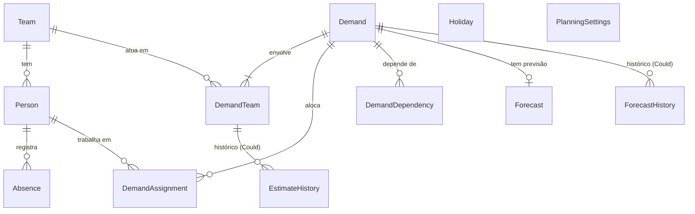

# TDD — Coordin

- **Status:** em elaboração — seções 1 a 4 aprovadas
- **Última atualização:** 2026-11-11
- **Fontes:** [`docs/PRD.md`](PRD.md) (aprovado em 2026-11-10) · [`docs/references/tcc-proposal.pdf`](references/tcc-proposal.pdf)

---

## 1. Contexto e objetivos técnicos

### 1.1 Resumo do produto

O Coordin é um sistema de planejamento e apoio à decisão para o gestor de desenvolvimento, seu **único usuário**. Ele transforma demandas priorizadas, esforço estimado em horas e capacidade dos times em previsões de entrega, compara sequências alternativas de execução e aponta ociosidade e sobrecarga. O gestor sempre decide; o sistema calcula, mostra o impacto e recomenda.

O PRD define 23 requisitos funcionais (Must RF-01 a RF-12, Should RF-13 a RF-19, Could RF-20 a RF-23), 8 não funcionais (RNF-01 a RNF-08) e 5 regras invioláveis (PRD 6.1). Este documento define **como** atendê-los.

### 1.2 Objetivos técnicos

| # | Objetivo | Origem |
|---|---|---|
| OT-1 | **Cálculo correto e determinístico:** previsão, margem, paralelismo, dependências, ociosidade/sobrecarga e cenários ficam em um motor de cálculo isolado, sem banco, HTTP ou interface, com entradas e saídas explícitas e sem relógio ou aleatoriedade não injetados. | RNF-02, RNF-08; `CLAUDE.md` §8.1 |
| OT-2 | **Regras invioláveis garantidas pelo motor,** e não pela interface: nenhum caminho de código pode reduzir o prazo pela margem, reordenar demandas sem aprovação ou dividir o prazo pelo número de times. | PRD 6.1 |
| OT-3 | **Recálculo rápido:** com 15 times, 150 pessoas e 200 demandas, cronograma em até 2 s e cenários recomendados em até 10 s. | RNF-01 |
| OT-4 | **Acesso pela rede, no navegador:** aplicação web hospedada, completa no computador e de consulta no celular (telas a partir de 360 px). | RNF-03; PRD R-02, R-08 |
| OT-5 | **Acesso protegido e dados mínimos:** login do gestor, senhas nunca em texto puro, apenas os dados pessoais necessários e nenhum dado real ou segredo no repositório. | RNF-04, RNF-05 |
| OT-6 | **Persistência confiável:** toda alteração confirmada sobrevive entre sessões e dispositivos. | RNF-06 |
| OT-7 | **Interface em português do Brasil,** com esforço e capacidade em horas e datas no fuso `America/Sao_Paulo`. | RNF-07 |
| OT-8 | **Entrega incremental:** cada change do OpenSpec entrega um conjunto de requisitos utilizável e testado, na ordem Must → Should → Could. | PRD 8.1, 10 |

### 1.3 Restrições

- **Prazo:** entrega em 2026-11-28. Marcos do PRD: TDD aprovado até 2026-11-13 (M3), Must até 2026-11-20 (M4), Should até 2026-11-24 (M5), congelamento em 2026-11-25 (M6). Toda decisão técnica favorece o que pode ser entregue e testado nesse prazo.
- **Usuário único:** um gestor e um planejamento; sem perfis, permissões por papel ou multi-inquilino (PRD 8.2).
- **Sem integrações nem notificações:** dados entram pelo próprio sistema; a única saída é a exportação em planilha (RF-19).
- **Stack:** a preferência é C#/.NET (`CLAUDE.md` §8.1), a confirmar na seção 3; versões e compatibilidade verificadas em documentação oficial.
- **Volume pequeno e conhecido:** até 15 times, 150 pessoas e 200 demandas (RNF-01), o que permite manter o planejamento inteiro em memória durante o cálculo.

### 1.4 Onde cada decisão delegada pelo PRD é fechada

| PRD 9.3 | Decisão | Seção do TDD |
|---|---|---|
| 1 | Modelo de capacidade e calendário | 4 (dados) e 6 (cálculo) |
| 2 | Paralelismo entre times | 6 |
| 3 | Representação de dependências e detecção de ciclos | 4 e 6 |
| 4 | Margem de segurança: tipo, etapa e unidade de arredondamento | 6 |
| 5 | Critério e método de otimização dos cenários | 6 |
| 6 | Registro de mudanças e previsto × realizado | 4 e 6 |
| 7 | Tamanho do período do relatório por time | 6 |
| 8 | Formato do arquivo exportado | 5 |
| 9 | Stack, autenticação e hospedagem | 3 e 7 |

---

## 2. Arquitetura

### 2.1 Visão geral

```
┌──────────────────────── Navegador (computador / celular) ───────────────────────┐
│  coordin-web (Angular SPA)                                                      │
└───────────────────────────────┬─────────────────────────────────────────────────┘
                                │ HTTPS · JSON · mesma origem
┌───────────────────────────────▼─────────────────────────────────────────────────┐
│  Coordin.Api (ASP.NET Core) — um único container                                │
│   • serve os arquivos estáticos do Angular                                      │
│   • endpoints HTTP, autenticação, validação de entrada, exportação              │
│   • persistência (EF Core) e mapeamento banco ⇄ motor                           │
│                      │ chama, passando um snapshot do planejamento              │
│   ┌──────────────────▼───────────────────┐                                      │
│   │ Coordin.Engine (biblioteca C# pura)  │  sem banco, HTTP, relógio ou I/O     │
│   │ previsão · margem · paralelismo ·    │                                      │
│   │ dependências · relatórios · cenários │                                      │
│   └──────────────────────────────────────┘                                      │
└───────────────────────────────┬─────────────────────────────────────────────────┘
                                │
                     ┌──────────▼──────────┐
                     │ PostgreSQL          │
                     └─────────────────────┘
```

| Componente | Responsabilidade | Não faz |
|---|---|---|
| `coordin-web` | Telas, navegação, formulários, apresentação do cronograma e dos relatórios; layout de consulta no celular | Nenhum cálculo de previsão ou regra de negócio |
| `Coordin.Api` | Endpoints, autenticação, validação de entrada, persistência, montagem do snapshot para o motor, gravação dos resultados, exportação em planilha | Nenhuma regra de cálculo |
| `Coordin.Engine` | Todas as regras de cálculo e as regras invioláveis, como funções determinísticas sobre entradas explícitas | Acesso a banco, rede, arquivos ou relógio do sistema |
| PostgreSQL | Armazenamento persistente | — |

### 2.2 Decisões

#### DT-01 — Monólito modular em uma única unidade de implantação

- **Contexto:** um usuário, volume pequeno (RNF-01), prazo curto e necessidade de acesso pela rede (RNF-03).
- **Alternativas consideradas:**
  - *Monólito modular (API + SPA servida pela própria API, em um container):* um deploy, mesma origem (sem CORS e com cookie de sessão simples), menos infraestrutura; front e back continuam separados no código.
  - *Front e API implantados separadamente:* escala e deploy independentes, mas exige CORS, dois deploys e configuração de domínio, sem benefício para um usuário.
  - *Microsserviços:* complexidade operacional injustificável para o escopo e o prazo.
- **Decisão:** monólito modular. A API ASP.NET Core serve o build estático do Angular e expõe os endpoints sob `/api`.
- **Justificativa:** menor custo de implantação e de segurança para o prazo; a separação de responsabilidades fica nos projetos (DT-02, DT-04), não na infraestrutura. Se um dia for preciso separar, o front já é uma SPA independente.
- **Atende:** RNF-03, RNF-04, RNF-06.

#### DT-02 — Motor de cálculo como biblioteca pura sobre um snapshot do planejamento

- **Contexto:** o cálculo concentra as regras invioláveis e os casos de borda que exigem testes (RNF-02, RNF-08; `CLAUDE.md` §8.1).
- **Alternativas consideradas:**
  - *Biblioteca pura com modelo próprio de entrada e saída:* a API monta um snapshot imutável (times, pessoas, capacidade, ausências, demandas, alocações, dependências, ordem de execução, parâmetros de margem e a data de referência) e recebe o resultado; testável sem banco e determinístico por construção.
  - *Regras nas entidades do EF Core ou em serviços da API:* menos mapeamento, mas acopla cálculo a banco e HTTP e dificulta testar.
- **Decisão:** biblioteca `Coordin.Engine` sem dependências externas de pacotes, com tipos de entrada e saída imutáveis (`record`s). A data de referência ("hoje") é sempre um parâmetro de entrada, nunca lida do relógio.
- **Justificativa:** isola o que mais importa testar; o custo é manter um mapeamento entre as entidades persistidas e o snapshot, aceito pelo ganho em testabilidade. O volume pequeno (até 200 demandas) permite recalcular o planejamento inteiro a cada vez, sem cálculo incremental.
- **Atende:** RF-08 a RF-10, RF-13, RF-17, RF-18, RNF-01, RNF-02, RNF-08; regras invioláveis 1 a 5.

#### DT-03 — Recalcular na escrita e persistir o resultado

- **Contexto:** o RF-12 exige guardar a primeira previsão de cada demanda, o RF-21 o histórico das previsões, e o RNF-01 limita o tempo de resposta.
- **Alternativas consideradas:**
  - *Recalcular a cada alteração e persistir as previsões:* toda escrita (cadastro, estimativa, ausência, alocação, ordem, aprovação de cenário) dispara o motor na mesma requisição e grava as previsões vigentes; a primeira previsão de cada demanda é gravada uma vez e nunca alterada. Leituras são rápidas e consistentes.
  - *Calcular só na leitura, sem persistir:* mais simples, mas não preserva a primeira previsão nem o histórico.
- **Decisão:** recalcular na escrita, dentro da mesma transação, e persistir as previsões vigentes. Simulações (RF-14, RF-16) e cenários recomendados (RF-13) chamam o motor sem persistir até a aprovação (RF-15) ou a confirmação.
- **Justificativa:** garante a linha de base do RF-12 e o histórico do RF-21 com a mesma estrutura; o custo de recalcular tudo é baixo no volume do RNF-01.
- **Atende:** RF-08, RF-12, RF-15, RF-16, RF-21, RNF-01, RNF-06.

#### DT-04 — Estrutura do repositório

- **Contexto:** o `CLAUDE.md` §3 adia a estrutura de código para o TDD.
- **Alternativas consideradas:**
  - *Monorepo com `src/` e `tests/`:* um repositório, uma branch por change, PRs que tocam front e back juntos.
  - *Repositórios separados para front e back:* PRs e versões desalinhados para uma mesma funcionalidade.
- **Decisão:** monorepo com a estrutura:

```
coordin/
├── src/
│   ├── Coordin.Engine/            # biblioteca pura de cálculo
│   ├── Coordin.Api/               # ASP.NET Core: endpoints, auth, persistência, export
│   └── coordin-web/               # Angular SPA
├── tests/
│   ├── Coordin.Engine.Tests/      # testes de unidade do motor (obrigatórios)
│   └── Coordin.Api.Tests/         # testes de integração da API
├── Coordin.slnx                   # solução .NET
├── compose.yaml                   # PostgreSQL para desenvolvimento local
├── Dockerfile                     # imagem única: API + build do Angular
├── docs/ · openspec/ · .github/ · .claude/
```

- **Justificativa:** cada change do OpenSpec entrega uma fatia vertical (motor, API e tela) em um único PR; o motor fica fisicamente separado, o que impede dependências acidentais de banco ou HTTP.
- **Atende:** `CLAUDE.md` §3 e §8.1.

---

## 3. Stack

Versões estáveis verificadas em 2026-11-11 nos registros oficiais (NuGet, npm) e na documentação oficial; as versões exatas são travadas no scaffold (arquivos de projeto e `package-lock.json`).

| Camada | Tecnologia | Versão |
|---|---|---|
| Runtime e linguagem | .NET 10 (LTS), C# 14 | SDK 10.0.4xx (instalado: 10.0.403) |
| API | ASP.NET Core 10, Minimal APIs, Problem Details | 10.0.x |
| Persistência | EF Core 10 + Npgsql | EF Core 10.0.15 · Npgsql.EntityFrameworkCore.PostgreSQL 10.0.3 |
| Banco | PostgreSQL | 18 |
| Front | Angular (componentes standalone, signals) | 22.2.x (CLI 22.2.6) |
| Linguagem do front | TypeScript | **6.0.x** (o Angular 22 exige `>=6.0 <6.1`; não usar o TypeScript 7) |
| Estilos | Tailwind CSS | 4.3.x |
| Runtime do front (build) | Node.js | 24 LTS (instalado: 24.21; o Angular 22 exige `^24.15`) |
| Testes .NET | xUnit v3 | 3.2.x |
| Testes front | Vitest (suportado pelo builder do Angular 22) | 5.x |
| Qualidade | `dotnet format`; ESLint (angular-eslint 22.x); Prettier 3.x | — |
| Ambiente local | Docker + Docker Compose (PostgreSQL) | Docker 29 (instalado) |

#### DT-05 — .NET 10 LTS agora; .NET 11 como atualização pendente

- **Contexto:** a preferência é C#/.NET na versão mais recente. O .NET 11 (STS) saiu em 2026-11-10 com EF Core 11 estável, mas o provedor PostgreSQL para EF Core 11 (Npgsql 11) ainda estava em release candidate (`11.0.0-rc.3`) em 2026-11-11.
- **Alternativas consideradas:**
  - *.NET 10 LTS:* tudo estável e já instalado; suporte até 2028-11; abre mão das novidades do .NET 11.
  - *.NET 11 com Npgsql RC:* versão mais nova, com risco de dependência de pré-lançamento na entrega.
  - *.NET 11 com EF Core 10 e Npgsql 10:* runtime novo com acesso a dados estável, mas mistura de versões principais.
- **Decisão:** .NET 10 LTS em todo o back-end. A atualização para o .NET 11 fica como pendência (seção 10), a fazer **somente** se sobrar tempo depois dos Should e com o Npgsql 11 estável publicado.
- **Justificativa:** a entrega não pode depender de pré-lançamento; a atualização entre versões principais do .NET costuma se limitar ao target framework e aos pacotes, e os testes do motor (RNF-08) validam a troca.
- **Atende:** RNF-01, RNF-06; restrição de prazo (1.3).

#### DT-06 — ASP.NET Core Minimal APIs com Problem Details

- **Contexto:** a API é consumida apenas pela SPA e tem poucas dezenas de endpoints.
- **Alternativas consideradas:**
  - *Minimal APIs agrupadas por recurso (`MapGroup`):* menos cerimônia, endpoints próximos da funcionalidade, bom suporte a validação, OpenAPI e Problem Details.
  - *Controllers MVC:* estrutura conhecida, mais código repetitivo para o mesmo resultado.
- **Decisão:** Minimal APIs agrupadas por recurso; erros no formato **Problem Details** (RFC 9457), com mensagens em português para o usuário.
- **Justificativa:** menos código para o prazo e um formato de erro padronizado que o front trata de um jeito só (critérios do PRD que exigem "mensagem clara", como RF-06 e RF-18).
- **Atende:** RF-06, RF-18, RNF-07.

#### DT-07 — PostgreSQL com EF Core

- **Contexto:** persistência entre sessões e dispositivos (RNF-06) e hospedagem acessível pela rede.
- **Alternativas consideradas:**
  - *PostgreSQL:* gratuito, robusto, disponível como serviço gerenciado na maioria das hospedagens e em Docker localmente.
  - *SQLite:* zero configuração, mas exige disco persistente na hospedagem.
  - *SQL Server:* integração nativa com .NET, mas opções gerenciadas gratuitas mais limitadas e imagem Docker pesada.
- **Decisão:** PostgreSQL 18, acessado com EF Core 10 e Npgsql 10; esquema versionado por migrations do EF Core; PostgreSQL local via Docker Compose.
- **Justificativa:** mesmo banco em desenvolvimento e produção, sem dependência da hospedagem escolhida.
- **Atende:** RNF-06.

#### DT-08 — Angular 22 + TypeScript 6.0 + Tailwind CSS

- **Contexto:** interface completa no computador e de consulta no celular (RNF-03); preferência por combinar C# com outras tecnologias.
- **Alternativas consideradas:**
  - *Angular + TypeScript:* framework completo e opinativo (roteamento, formulários, HTTP, signals) e tipagem forte; combina C# no back com TypeScript no front.
  - *React + TypeScript:* maior ecossistema de componentes, mais escolhas de bibliotecas a fazer.
  - *Blazor:* tudo em C#, com menos ecossistema de componentes de cronograma.
- **Decisão:** Angular 22 com componentes standalone e signals, TypeScript 6.0.x e Tailwind CSS 4 para o layout responsivo. Sem biblioteca de componentes visuais: os componentes são próprios, estilizados com Tailwind.
- **Justificativa:** escolha do autor; o Angular traz pronto o que o PRD exige (formulários com validação, roteamento, cliente HTTP), e o Tailwind agiliza o layout do computador e do celular sem uma biblioteca de componentes pesada.
- **Atende:** RNF-03, RNF-07.

#### DT-09 — Hospedagem: **PENDENTE**

- **Contexto:** o acesso pelo computador e pelo celular exige o sistema acessível pela rede (RNF-03, PRD R-02). O marco M4 (2026-11-20) exige os Must acessíveis pela rede.
- **Alternativas consideradas:**
  - *Container Docker em PaaS* (por exemplo, Render, Railway ou Fly.io) com PostgreSQL gerenciado: implanta a imagem única do DT-01, independe da versão do .NET.
  - *Azure App Service:* ecossistema Microsoft, possível crédito de estudante.
  - *Servidor virtual próprio:* mais controle, mais configuração e manutenção.
- **Recomendação:** container Docker em PaaS com PostgreSQL gerenciado.
- **Decisão:** pendente; o autor vai validar a opção com o professor orientador. **Prazo para decidir: 2026-11-14**, para que a implantação caiba no M4.
- **Atende:** RNF-03, RNF-06.

---

## 4. Modelo de dados

### 4.1 Diagrama



### 4.2 Entidades

Tipos: identificadores `Guid` versão 7 (`uuid`); datas de planejamento `DateOnly` (`date`); instantes `DateTimeOffset` gravados em UTC (`timestamptz`) e exibidos no fuso `America/Sao_Paulo`; horas `decimal` com duas casas.

| Entidade | Atributos principais | Regras de integridade | Requisitos |
|---|---|---|---|
| `Team` | `Id`, `Name` | `Name` obrigatório e único (sem diferenciar maiúsculas) | RF-01 |
| `Person` | `Id`, `Name`, `TeamId`, `DailyCapacityHours` | Um único time (FK obrigatória); `DailyCapacityHours` entre 0 e 24 | RF-02 |
| `Absence` | `Id`, `PersonId`, `Type` (`Vacation`, `Other`), `StartDate`, `EndDate` | `EndDate >= StartDate`; sem motivo detalhado (RNF-05) | RF-03 |
| `Holiday` | `Id`, `Date`, `Description` (opcional) | `Date` única | RF-03 |
| `Demand` | `Id`, `Title`, `PriorityRank`, `ExecutionRank`, `StartDate` (opcional), `InformedEndDate` (opcional), `CompletedOn` (opcional), `ActualEffortHours` (opcional, Could) | `PriorityRank` e `ExecutionRank` únicos e contínuos a partir de 1; `CompletedOn >= StartDate`; `ActualEffortHours > 0` quando informado | RF-04, RF-07, RF-12, RF-22 |
| `DemandTeam` | `DemandId`, `TeamId`, `EstimatedEffortHours` (opcional) | Chave (`DemandId`, `TeamId`); `EstimatedEffortHours > 0` quando informado | RF-05, RF-06 |
| `DemandAssignment` | `DemandId`, `PersonId` | Chave (`DemandId`, `PersonId`); o time da pessoa precisa estar entre os times da demanda | RF-05 |
| `DemandDependency` | `DemandId`, `PrerequisiteDemandId` | Chave composta; sem autodependência; ciclos rejeitados pela API usando o motor (seção 6) | RF-18 |
| `Forecast` | `DemandId`, `IsPredictable`, `UnpredictableReason`, `ForecastStartDate`, `EndDateWithoutMargin`, `ForecastEndDate`, `BaselineEndDate`, `CalculatedAt` | Uma por demanda; `ForecastEndDate >= EndDateWithoutMargin`; `BaselineEndDate` gravada uma única vez | RF-08 a RF-12 |
| `ForecastHistory` | `Id`, `DemandId`, `PreviousEndDate`, `NewEndDate`, `Cause`, `ChangedAt` | Somente inclusão | RF-21 (Could) |
| `EstimateHistory` | `Id`, `DemandId`, `TeamId`, `PreviousHours`, `NewHours`, `Reason` (opcional), `ChangedAt` | Somente inclusão | RF-20 (Could) |
| `PlanningSettings` | `ExecutionOrderMode` (`FollowPriority`, `Custom`) e os parâmetros da margem de segurança (definidos na seção 6) | Registro único | RF-09, RF-15 |

A conta de acesso do gestor é definida na seção 7. Cenários (RF-13, RF-14) e a simulação de nova demanda (RF-16) **não são persistidos** (DT-03): apenas o resultado aprovado altera `ExecutionRank` ou cria a demanda.

### 4.3 Decisões

#### DT-10 — Capacidade em horas por dia útil, com calendário do setor

- **Contexto:** modelo de capacidade delegado pelo PRD (9.3, item 1; `CLAUDE.md` §7.3), incluindo ausências, outras alocações e calendário.
- **Alternativas consideradas:**
  - *Horas por dia útil, um número por pessoa:* simples de cadastrar e de calcular; outras alocações da pessoa já ficam descontadas no número informado; não representa jornadas irregulares.
  - *Horas por dia da semana:* cobre jornadas irregulares, com mais cadastro e cálculo.
- **Decisão:** cada pessoa tem `DailyCapacityHours`. A capacidade de uma pessoa em uma data é `DailyCapacityHours` se a data for de segunda a sexta, não for feriado (`Holiday`) e não estiver em uma ausência da pessoa (`Absence`); caso contrário, zero. A capacidade de um time em uma data é a soma das capacidades das pessoas dele.
- **Justificativa:** atende ao RF-02 e ao RF-03 com o menor modelo possível. Feriados foram incluídos no PRD (RF-03, ajuste aprovado em 2026-11-11) para não tratar feriado como dia de trabalho.
- **Atende:** RF-02, RF-03, RF-08, RF-17.

#### DT-11 — Esforço estimado por time da demanda

- **Contexto:** paralelismo entre times (PRD 9.3, item 2) e a regra inviolável 4 (adicionar um time não divide o prazo automaticamente).
- **Alternativas consideradas:**
  - *Esforço por demanda × time (`DemandTeam.EstimatedEffortHours`):* cada time estima a sua parte; cada parte é executada com a capacidade do próprio time e a demanda termina quando a última parte termina. O paralelismo é explícito nos dados.
  - *Esforço total dividido pelo motor:* um número por demanda, repartido pela capacidade; exige um fator de eficiência para não virar divisão exata.
- **Decisão:** esforço por demanda × time. O esforço total da demanda é a soma das partes. A demanda só é previsível quando todos os times alocados têm estimativa.
- **Justificativa:** fiel a "os times informam o esforço" e garante a regra 4 por construção, sem um fator arbitrário. O PRD foi ajustado em RF-06 e RF-10 (aprovado em 2026-11-11).
- **Atende:** RF-05, RF-06, RF-08, RF-10; regra inviolável 4.

#### DT-12 — Alocação de pessoas inteiras, em fila por ordem de execução

- **Contexto:** RF-05 exige alocar pessoas às demandas e compartilhar a capacidade respeitando a ordem de execução.
- **Alternativas consideradas:**
  - *Pessoa inteira em fila:* cada pessoa trabalha nas demandas a que está alocada uma de cada vez, na ordem de execução; uma demanda posterior só recebe horas da pessoa quando as anteriores não precisarem mais dela.
  - *Percentual da pessoa por demanda:* mais flexível, com mais dados e risco de ultrapassar 100%.
  - *Só o time, sem pessoas:* mais simples, mas contraria o RF-05.
- **Decisão:** `DemandAssignment` liga pessoa e demanda, sem percentual. A parte de um time na demanda é executada pelas pessoas desse time alocadas a ela. Uma parte sem pessoas alocadas torna a demanda não previsível ("sem capacidade", RF-10).
- **Justificativa:** respeita o RF-05 e o RF-08 (demanda posterior não toma capacidade de anterior) com um modelo simples; o algoritmo da fila é detalhado na seção 6.
- **Atende:** RF-05, RF-08, RF-10.

#### DT-13 — Ordem de prioridade e ordem de execução separadas

- **Contexto:** RF-04 e RF-15 exigem preservar a prioridade registrada e permitir uma ordem de execução aprovada diferente (regras invioláveis 2 e 3).
- **Alternativas consideradas:**
  - *Dois rankings na demanda (`PriorityRank`, `ExecutionRank`) e um modo global:* com `FollowPriority`, o motor usa a prioridade; com `Custom`, usa a ordem aprovada. Voltar à prioridade (RF-15) é trocar o modo.
  - *Um único ranking:* aprovar cenário apagaria a prioridade combinada com o produto.
- **Decisão:** dois rankings mais `PlanningSettings.ExecutionOrderMode`. Aprovar um cenário grava o `ExecutionRank` de todas as demandas e muda o modo para `Custom`. No modo `Custom`, uma nova demanda entra no fim da ordem de execução, e o cronograma sinaliza a divergência em relação à prioridade (RF-15).
- **Justificativa:** a prioridade nunca é sobrescrita por uma decisão de sequência, e a divergência fica visível.
- **Atende:** RF-04, RF-11, RF-15; regras invioláveis 2 e 3.

#### DT-14 — Linha de base e históricos somente de inclusão

- **Contexto:** registro de mudanças e previsto × realizado (PRD 9.3, item 6).
- **Alternativas consideradas:**
  - *Linha de base como coluna gravada uma vez e históricos em tabelas somente de inclusão:* simples de consultar e impossível de "corrigir" por engano.
  - *Versionar o planejamento inteiro a cada alteração:* reconstrói qualquer momento, mas é desproporcional ao escopo.
- **Decisão:** `Forecast.BaselineEndDate` é gravada no primeiro cálculo em que a demanda se torna previsível e nunca é alterada. `ForecastHistory` e `EstimateHistory` (Could) só recebem inclusões; a API não expõe edição nem exclusão delas.
- **Justificativa:** atende ao RF-12 nos Must sem depender dos Could; os históricos podem ser implementados depois sem mudar o restante do modelo.
- **Atende:** RF-12, RF-20, RF-21, RF-23.

#### DT-15 — Identificadores e tipos de dados

- **Contexto:** consistência entre banco, API e motor; datas sem fuso para o planejamento e instantes com fuso para auditoria (RNF-07).
- **Alternativas consideradas:**
  - *`Guid` v7, `DateOnly` e `DateTimeOffset` em UTC:* identificadores gerados na aplicação, ordenáveis no tempo e sem colisão; datas de planejamento sem ambiguidade de fuso.
  - *Inteiros autoincrementais e `DateTime`:* identificadores mais curtos, mas expostos na URL de forma sequencial, e `DateTime` mistura data e fuso.
- **Decisão:** `Guid.CreateVersion7()` para identificadores; `DateOnly` para datas de planejamento; `DateTimeOffset` em UTC para instantes; `decimal` com duas casas para horas.
- **Justificativa:** o motor trabalha com dias (`DateOnly`), o que elimina erros de fuso no cálculo; o fuso `America/Sao_Paulo` só é aplicado na exibição.
- **Atende:** RNF-02, RNF-07.

### 4.4 Exclusões

- Um time com pessoas não pode ser excluído; uma pessoa alocada a demanda não concluída também não.
- Excluir uma demanda remove suas partes por time, alocações, dependências e previsão, e recompacta os rankings; demandas concluídas não são excluídas, para preservar a métrica principal.
- Excluir uma pessoa remove suas ausências.
